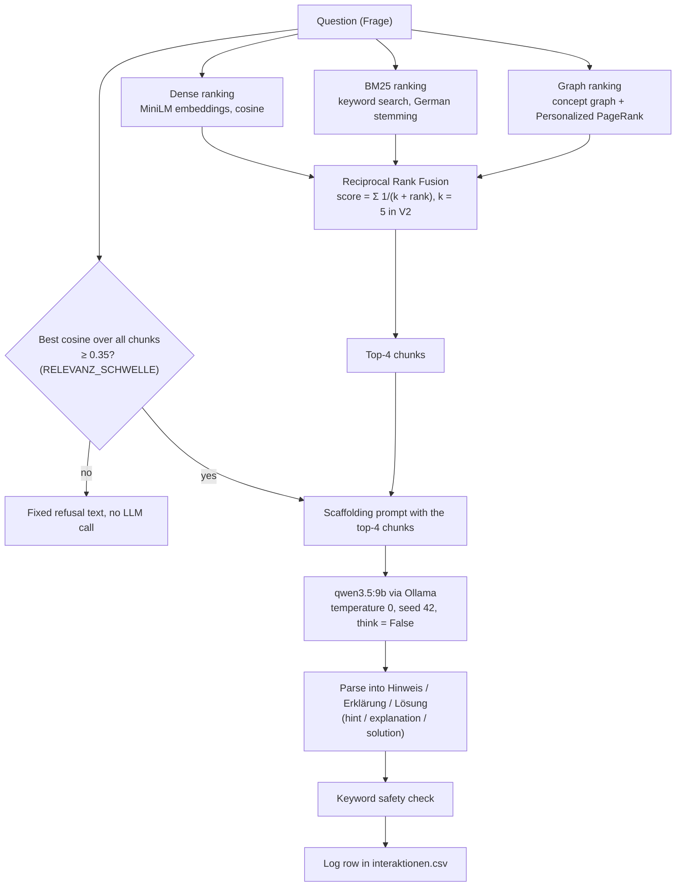

# Entwicklung und Evaluation — KI-Lernassistent (RAG)
*(English title: Development and Evaluation — AI Learning Assistant)*

**Purpose of this document:** a complete, self-contained explanation of the technical work on the learning assistant, from the knowledge base to version V2. It is written for my own understanding. The main text is in English. Every German term, code name, prompt or quotation is followed by an English translation.

**State described:** repository `Lernassistenz_RAG`, commit `7c9d2bb` (8 Oct 2026), evaluated versions V0 → V2.

**How to read the markers**
| Marker | Meaning |
|---|---|
| **[Source]** | A published paper or official resource; full reference in §14 |
| **[Own data]** | A number measured in this project; the file it comes from is named |
| **[Dev log]** | Comes from the development conversation, not from an archived file I could re-check |
| **⚠ not verified** | Plausible but I could not check it against a file or source; treat with care |
| **(RL)** after a reference | The paper is in the Notion "Paper Reading list" with my own reading notes |

---

## Contents
1. Research context: why this system exists
2. System overview
3. Knowledge base (Wissensbasis)
4. Retrieval: dense, BM25, hybrid, concept graph
5. Answer generation and scaffolding
6. Logging, test set and run infrastructure
7. Evaluation method: RAGAS and retrieval metrics
8. Version history and results
9. Main findings, explained
10. Repository and reproducibility
11. Limitations and threats to validity
12. Open issues and next steps
13. Glossary: German terms in the code
14. References

---

## 1. Research context: why this system exists

### 1.1 Goal
The dissertation develops and evaluates a **trustworthy, domain-specific AI learning assistant for technical and vocational education** (German: *technische und berufliche Bildung*, TVET). The research concept states the problem like this:

> *„Gleichzeitig stellen Halluzinationen, mangelnde Transparenz und eine oft unzureichende Ausrichtung an curricularen Inhalten insbesondere in der technischen und beruflichen Bildung eine Herausforderung dar, da fehlerhafte Informationen sowohl den Lernerfolg als auch sicherheitsrelevante Entscheidungen beeinflussen können."*
>
> *"At the same time, hallucinations, a lack of transparency and often insufficient alignment with curricular content are a challenge, especially in technical and vocational education, because incorrect information can affect both learning success and safety-relevant decisions."*
> — Forschungskonzept (research concept), v2

The proposed solution is **Retrieval-Augmented Generation (RAG)**: the language model does not answer from its own memory but from passages retrieved from a fixed, curated knowledge base **[Source: Lewis et al., 2020 (RL); Gao et al., 2024]**.

### 1.2 Research questions
The four research questions from the research concept (they were later revised for the colloquium; the revised wording is not in the files I have):

| | German original | English |
|---|---|---|
| F1 | Wie kann ein fachspezifischer KI-Lernassistent Lernende bei technischen Lern-, Fehlerdiagnose- und Problemlöseprozessen unterstützen? | How can a domain-specific AI learning assistant support learners in technical learning, fault-diagnosis and problem-solving processes? |
| F2 | Welche Gestaltungsprinzipien und Sicherheitsmechanismen verbessern die Vertrauenswürdigkeit, Transparenz und pädagogische Qualität von KI-generierten Antworten? | Which design principles and safety mechanisms improve the trustworthiness, transparency and pedagogical quality of AI-generated answers? |
| F3 | Wie beeinflusst der Einsatz eines KI-Lernassistenten den Lernerfolg, das selbstregulierte Lernen und das Vertrauen der Lernenden in technischen Bildungskontexten? | How does using an AI learning assistant affect learning success, self-regulated learning and learners' trust in technical education? |
| F4 | Wie können Lehrkräfte sinnvoll in KI-gestützte Lernumgebungen eingebunden werden, um fachliche Qualität und Lehrplanbezug sicherzustellen? | How can teachers be meaningfully integrated into AI-supported learning environments to ensure subject quality and curriculum alignment? |

**Everything in this document belongs mainly to F2:** it is about *which technical design choices make answers more grounded and more honest*. F3 and F4 need the pilot study with learners and teachers, which has not happened yet.

### 1.3 Method: Design-Based Research
The project follows **Design-Based Research (DBR)**: build a prototype, test it, learn from the results, improve it, test again **[Source: Design-Based Research Collective, 2003; Reeves, 2006 — both cited in `rag_pipeline.py`]**. The version-by-version work in this document (V0 → V1 → V2) is one such cycle at the technical level: **one change per version, measured with the same test set and the same judge**, so that each difference can be attributed to that change.

### 1.4 The four pillars (Säulen)
The system concept has four pillars. This document touches the first three:

| Pillar (German) | English | Where in this document |
|---|---|---|
| Grounding | Answers based on sources | Retrieval (§4), prompt (§5), faithfulness (§7) |
| Sicherheit | Safety: refuse rather than guess, flag safety topics | Relevance gate (§4.2), refusals (§7.3), F020 finding (§9.6) |
| Lernunterstützung | Learning support: scaffolding | Three-stage answer (§5) |
| Lehrkraftintegration | Teacher integration | Not yet implemented (§12) |

---

## 2. System overview

### 2.1 Files and their roles
| File | Role | Used by learners? |
|---|---|---|
| `app.py` | Study app (Streamlit, port 8501): session ID, chat with scaffolding, questionnaire | Yes |
| `admin_app.py`, `baue_wissensbasis.py` | Build the knowledge base from PDFs (port 8502 / command line) | No |
| `rag_pipeline.py` | Core: knowledge base, retrieval, prompt, LLM call, logging, questionnaire items | Indirectly |
| `wissensgraph.py` | V2 concept graph (*Wissensgraph* = knowledge graph) | Indirectly (only if `hybrid_kg` is selected) |
| `fuehre_testfragen_aus.py` | Batch run: all test questions through the real pipeline (*führe Testfragen aus* = run test questions) | No |
| `ragas_auswertung.py` | RAGAS evaluation with a local judge model (*Auswertung* = evaluation) | No |
| `retrieval_vergleich.py` | Retrieval-only comparison without LLM (*Vergleich* = comparison) | No |
| `vergleiche_versionen.py` | Table and charts across versions (*vergleiche Versionen* = compare versions) | No |
| `verweigerung_neu_klassifizieren.py` | Re-applies the improved refusal detector to archived runs (*Verweigerung neu klassifizieren* = reclassify refusals) | No |
| `frage_testen.py`, `graph_erklaeren.py` | Diagnostics for one question (*Frage testen* = test a question; *Graph erklären* = explain the graph) | No |
| `retrieval_erklaeren.py` | Follows one question from head to tail as an HTML page: all retrieval methods (dense, BM25, graph, RRF, reranker), generation (prompt, raw output, Hinweis/Lösung, rule checks) and RAGAS with formulas and worked numbers (faithfulness statements with JA/NEIN, answer-relevance questions with cosines, context-relevance sentences), plus this question's Recall@4/MRR contribution. Same functions as the pipeline and `ragas_auswertung.py`, with a built-in retrieval cross-check; output contains handbook text → `evaluationsdaten/frage_erklaerung_*.html` is gitignored | No |
| `testfragen_v1.csv` | The 30 test questions (*Testfragen* = test questions) | No |

**Folder structure from V7 (13 Oct 2026; created by `ordne_projekt.py`).** The table above lists file roles; their locations are:

| Folder | Content |
|---|---|
| project root | `app.py`, `admin_app.py`, `requirements.txt`, `README.md` |
| `lernassistent/` | library: `rag_pipeline.py`, `wissensgraph.py`, `ideen_feedback.py`, `pdf_struktur.py`, `bildbeschreibung.py`, `pfadsetup.py` |
| `skripte/wissensbasis/` | KB building: `baue_wissensbasis.py` (formerly `wissenbasis.py`), `baue_zweite_wissensbasis.py`, `baue_wissensbasis_struktur.py`, `pilot_extraktion.py`, `ordne_chunks_zu.py` |
| `skripte/evaluation/` | batch run, RAGAS, comparisons, `stufen_check.py`, archiving |
| `skripte/diagnose/` | single-question tools (`frage_testen.py`, `graph_erklaeren.py`, `retrieval_erklaeren.py`) |
| `skripte/setup/`, `skripte/laeufe/` | `pruefe_umgebung.py`; run scripts (`nachtlauf_V6_V7.sh`) |
| `daten/quellen/<buch>/` | source PDFs (gitignored) |
| `daten/wissensbasen/` | `knowledge_base_<buch>.json`, `…_v7a.json`, `…_v7b.json` (gitignored) |
| `daten/extraktion/<buch>/` | MinerU output, image cache, figure descriptions (gitignored) |
| `daten/testfragen/` | test sets; Fischer sets contain anchor quotes → gitignored |
| `evaluationsdaten/` | logs and archived runs (unchanged) |
| `doku/`, `protokolle/`, `alt/` | documentation; console logs (gitignored); old files (gitignored) |

Every script starts with a two-line header that adds `lernassistent/` to the import path and imports `pfadsetup`, which also changes the working directory to the project root, so all relative paths work from any folder.

### 2.2 Data flow for one question (current code, `hybrid_kg`)

The study app (`app.py`) still uses `RETRIEVAL_METHODE = "dense"` (V0 behaviour). The newer methods are only used where they are passed explicitly (batch runs, diagnostics). **Learners have so far only been able to see V0.**

### 2.3 Hardware and software
| Item | Value | Evidence |
|---|---|---|
| GPU | NVIDIA RTX 3070 Laptop, 8 GB VRAM | nvitop screenshot during the T0a run |
| OS | Windows + WSL2 Ubuntu; conda env `pilot_rag` (Python 3.11) | project memory |
| LLM server | Ollama **0.33.0** on Windows, reached from WSL via the gateway IP | `lauf_*.json` |
| Generator | `qwen3.5:9b` | `lauf_*.json` |
| Judge | `mistral-nemo` (Mistral NeMo 12B) | `ragas_ergebnisse.csv` column `richter` (*judge*) |
| Embeddings | `paraphrase-multilingual-MiniLM-L12-v2` (sentence-transformers) | `lauf_*.json` |

**Why everything is local:** data protection for learner data and independence from cloud services. The 8 GB VRAM limit is the main technical constraint: the generator (9B) and the judge (12B) cannot run at the same time, which is why generation and evaluation are two separate steps.

---

## 3. Knowledge base (Wissensbasis)

### 3.1 Content
A large German mechanical-engineering reference handbook of about 1,700 pages (project notes: ~1,721 pages; the test questions reference pages up to 1,564). It covers materials, machine elements, thermodynamics, electrical drives, control engineering, manufacturing, CNC, hydraulics and business economics. It is used as a **test corpus** for system validation, not as final curriculum material.

| Property | Value | Evidence |
|---|---|---|
| Number of chunks | **31,990** | `lauf_*.json` (`anzahl_chunks` = number of chunks) |
| Fingerprint | `kb_hash = 97da9ea85ed3` | `lauf_*.json` (all five evaluated runs) |
| Chunk IDs | `pdf_0001` … (consecutive) | `testfragen_v1.csv` |

### 3.2 How it was built
The build script `baue_wissensbasis.py` (*baue Wissensbasis* = build knowledge base) was not in the package I received. The description below comes from the functions it calls in `rag_pipeline.py` and from `README.md`/`PROZESSABLAUF.md`. **⚠ not verified:** the exact parameters used for this particular build (the defaults are listed).

1. **Page-by-page text extraction** with `pypdf` (`verarbeite_pdf_seitenweise` = process PDF page by page). Each chunk belongs to exactly one page.
2. **Chapter assignment** from the PDF's bookmarks (`lese_pdf_gliederung` = read PDF outline; `thema_fuer_seite` = topic for page): each page gets the title of the last bookmark before it, e.g. *„76.4 Quasistetige Regler"* (*quasi-continuous controllers*).
3. **Sentence splitting** (`_satzsplit`) with protection for abbreviations like *„z.B."*, *„Prof."*, *„bzw."* (*e.g.*, *Prof.*, *respectively*).
4. **Semantic chunking** (`chunke_text_semantisch`): consecutive sentences are embedded; when the cosine similarity between two neighbouring sentences falls below **0.55** (`aehnlichkeits_schwelle` = similarity threshold), a new chunk starts. Maximum **8 sentences** per chunk as a safety limit.
5. **Overlap:** the last **1 sentence** of a chunk is repeated at the start of the next (`ueberlapp_saetze = 1`, *overlap sentences*), so a fact at a boundary appears in both chunks **[Source: Modran, 2025, cited in code; RL]**.
6. Chunks shorter than **25 characters** are dropped.
7. According to `README.md`/`PROZESSABLAUF.md`, the file is written atomically (`sichere_json_schreiben` = write JSON safely), so an interrupted save cannot leave a broken file. ⚠ not verified: this function is not in the `rag_pipeline.py` version I had (probably in the build script).

**Justification for semantic chunking:** a fixed sentence count cuts through topics arbitrarily; boundaries at drops in similarity follow the content. The literature supports semantic over fixed-size chunking without hard numbers **[Source: Oche et al., 2025, §6.4 (RL)]**. Contrary evidence also exists: Bennani & Moslonka (2026) found no benefit from overlap and similar results for sentence and semantic chunking **(RL, preprint)**. The threshold 0.55 is a starting value, not calibrated (stated in the code and in `README.md`).

### 3.3 Cleaning step: placeholder chunks removed
**[Dev log]** The knowledge base still contained 12 placeholder chunks `kb_001`–`kb_012` from an early demo version, mixed into the real knowledge base (the README describes the original placeholder file with 21 chunks; 12 were found in the built knowledge base — ⚠ the reason for the difference was not investigated) (README: *„sorgfältig erstellter Platzhalterinhalt (21 Chunks, 7 Themen)"* = *carefully created placeholder content, 21 chunks, 7 topics*). They were removed (32,002 → 31,990 chunks), which changed the fingerprint to `97da9ea85ed3`. A backup was kept as `knowledge_base_mit_platzhaltern.json` (*with placeholders*). All runs compared in §8 use the cleaned knowledge base.

### 3.4 Why the fingerprint (`kb_hash`) exists
Every logged interaction stores the first 12 characters of the SHA-256 hash of `knowledge_base.json` (`berechne_kb_hash` = compute KB hash). If the knowledge base is rebuilt, chunk IDs like `pdf_3734` may point to different text. The evaluation therefore refuses to score a logged answer whose `kb_hash` differs from the current file (exclusion reason `kb_hash_abweichend` = *kb_hash differs*). Without this check, old answers would be silently judged against the wrong context.

### 3.5 Known weaknesses of the knowledge base
| Weakness | Example | Consequence |
|---|---|---|
| **Extraction artefacts** in formulas | Chunk `pdf_29144`: *„y.k/D KPR/SOH " e.k/C T Tn k/NUL1X …"* — control characters such as SOH and NUL appear as text, "D" stands for "=" | BM25, embeddings, the judge and qwen all see garbage. The judge prompts contain an explicit note about this (§7.4). |
| **Hyphenation** from line breaks | *„Stellgrößen- folge"*, *„quasisteti- gen"* | Words split in two; `tokenisiere` (§4.3) re-joins *word-\nword* only when a line break follows the hyphen |
| **Overlap only within a page** | — | A fact split across a page break is still lost (README, known open point) |
| **Chapter assignment partly wrong** | — | The judge prompts deliberately leave chapter titles out (`kontexttext`, comment: *„Die Kapitelzuordnung ist teilweise fehlerhaft"* = *the chapter assignment is partly wrong*) |
| **Copyright** | The handbook is a commercial publication | The knowledge base must never be published (§10.3) |

---

## 4. Retrieval

Retrieval decides which 4 chunks (`top_k = 4`) the model sees. Everything later depends on it: if the right passage is not among the 4, the model can only refuse or guess.

### 4.1 Dense retrieval (V0)
**What it does:** every chunk and the question are turned into vectors by `paraphrase-multilingual-MiniLM-L12-v2`; the chunks with the highest cosine similarity to the question are returned.

**Justification at the time (V0):**
- Embeddings capture meaning, not just word surface **[Source: Reimers & Gurevych, 2019]**. The multilingual `paraphrase-multilingual-*` models were trained by knowledge distillation so that sentences with the same meaning in different languages map to similar vectors **[Source: Reimers & Gurevych, 2020 (RL)]**; MiniLM is a compact distilled transformer **[Source: Wang et al., 2020]**.
- Own Phase-1 finding: TF-IDF failed on German word-form variants (*„einfachwirkenden"* vs. *„einfachwirkender"* = *single-acting*, two inflections) **[Dev log, documented in `PROZESSABLAUF.md`]**.
- `top_k = 4` instead of 2: a short fact (an ECTS number in Phase 1) was pushed out by related prose **[Dev log; `PROZESSABLAUF.md` notes that no systematic top_k comparison was done]**.

**Storage:** the embeddings of all 31,990 chunks are computed when the program starts and kept in memory (`_chunk_embedding_cache`). At this size, a brute-force cosine over all chunks is fast enough; a vector database is not needed. Cost: a noticeable delay at program start (⚠ estimate: tens of seconds); the first question of the V2-KG batch run took 57 s, the others 4–8 s **[Own data: console output of the V2-KG run]**.

**Measured weakness [Own data: `k_sweep.txt`]:** dense retrieval found the source chunk in the top 4 for only **6 of 25** questions; the median rank of the source chunk was **94**. Several questions had the source chunk at ranks in the thousands (e.g. question 4: rank 19,234; question 20: rank 8,547).

**Why dense fails here:** the small multilingual model "blurs" exact technical terms. Typical example (§9.2): for *„Was bringt der D-Anteil in einem Regler?"* (*What does the D-component do in a controller?*), dense ranked a chunk about the damping ratio "D" (*„Lehr'sches Dämpfungsmaß … Wert D"*) at rank 1, because it matched the single letter "D". This matches the literature: dense models often generalise poorly out of domain, BM25 is a robust baseline **[Source: Thakur et al., 2021, BEIR (RL)]**; on a maths textbook, BM25 beat 2 of 5 embedding models and the multilingual model was worst **[Source: Chen et al., 2025 (RL, preprint)]**; technical German is effectively a low-resource domain for embeddings **[Source: Zhukova et al., 2025 (RL)]**.

### 4.2 Relevance gate (RELEVANZ_SCHWELLE = 0.35)
**What it does:** before generating, the system takes the **highest cosine similarity between the question and any chunk** (`bester_score` = best score). If it is below 0.35, no LLM call happens and a fixed refusal is shown:

> *„Dazu habe ich in den Lernmaterialien keine ausreichend passende Quelle gefunden und möchte deshalb keine geratene Antwort geben. Bitte wende dich an deine Lehrkraft oder formuliere die Frage genauer."*
>
> *"I couldn't find a sufficiently matching source for this in the learning materials and therefore don't want to give a guessed answer. Please ask your teacher or phrase the question more precisely."*

**Justification:** refuse rather than guess is the core safety measure. It addresses the "tug-of-war" between retrieved evidence and the model's internal knowledge **[Source: Oche et al., 2025, §7.1.3, primary source Jin et al., 2024 (RL)]**, and it implements the grounding principle of RAG **[Source: Lewis et al., 2020]**.

**Design detail since V1:** the field `score` of each chunk is *always* the dense cosine, even when BM25, hybrid or the graph decides the ranking. So the gate and the logged `bester_score` are defined identically in all versions; only the selection of chunks changes. This keeps "one change per version" clean.

**Measured result: the gate never fires.** **[Own data]** In every complete reference run (V0-DENSE-T0, V1-HYBRID-T0b, V2-KG), all 30 questions appear in the evaluation with gap-free case IDs; a gate refusal would have left a gap. So 0 of 30 questions were refused by the gate. Even off-topic questions (*„Welche Zutaten brauche ich für einen Pizzateig?"* = *What ingredients do I need for pizza dough?*) find some chunk above 0.35 in a 1,700-page handbook. All correct refusals in this document come from the **model**, not from the gate. **⚠ not verified:** the exact best-score values of the off-topic questions (they are in the `testlauf_retrieval_*.csv` reports, which were not in the package). One open detail: in two runs one question is missing entirely: **question 24** (*Hartdrehen*, hard turning) in `V1-BM25-T0` and **question 23** (*Schleifscheibe*, grinding wheel) in `V1-HYBRID-T0`. Their case IDs run without a gap, so these questions never reached the log (an excluded case would still use up a case ID). The most likely cause is an error during the batch run: `fuehre_testfragen_aus.py` retries only on connection errors; any other error (e.g. a timeout of the 120 s LLM call) is reported as FEHLER (*error*) and the question is skipped. **⚠ not verified** (the console output was not archived).

### 4.3 BM25 keyword search (V1)
**What it does:** BM25 is the standard probabilistic keyword ranking: a chunk scores high if it contains the question's words, rare words count more, and very long chunks are penalised **[Source: Robertson & Zaragoza, 2009]**. Implementation: `rank_bm25.BM25Okapi` (Python package `rank_bm25`).

**Tokenizer (`tokenisiere` = tokenize):**
1. Re-join hyphenations from line breaks: *„Kurbel-\numdrehungen"* → *„kurbelumdrehungen"* (*crank revolutions*).
2. Lowercase; keep only letters (incl. ä, ö, ü, ß) and digits.
3. Drop words shorter than 2 characters and German stopwords (a fixed list of 152 function words such as *„der, die, das, und, wie"* = *the, and, how*).
4. **Snowball German stemming** **[Source: Porter, 2001]**, so that *„Verriegelung"* and *„Verriegelungen"* (*interlock*, singular/plural) become the same token.

**Caching:** tokenizing 31,990 chunks takes about a minute, so the token lists are stored in `cache/bm25_tokens_<fingerprint>.pkl`; the fingerprint is a hash of all chunk texts, so a changed knowledge base automatically gets a new cache.

**Justification:** technical terms (*Zweihandverriegelung* = *two-hand interlock*, *D-Anteil*, *DIN EN 13001-2*, *CNC*) are exact strings that a small embedding model blurs. Benchmarks show BM25 as a strong out-of-domain baseline **[Source: Thakur et al., 2021 (RL)]**; for terminology- and table-heavy documents, hybrid BM25 + dense is best **[Source: T²-RAGBench, 2025 (RL)]**.

**Result [Own data: `k_sweep.txt`]:** BM25 alone found the source chunk in the top 4 for **9 of 25** (dense: 6), median rank **8** (dense: 94).

**Known limitation found later (§9.2):** the tokenizer splits hyphenated compounds. *„D-Anteils"* becomes *„d"* + *„anteil"*; *„d"* is dropped (shorter than 2 characters), and *„anteil"* (*component, share*) is extremely common (P-Anteil, I-Anteil, Anteil …). BM25 effectively cannot see the term "D-Anteil".

### 4.4 Hybrid: Reciprocal Rank Fusion (V1)
**What it does:** dense and BM25 each produce a full ranking of all chunks. Each chunk then gets

  **RRF score = 1 / (k + rank in dense list) + 1 / (k + rank in BM25 list)**

and the chunks are sorted by this sum **[Source: Cormack, Clarke & Büttcher, 2009 (RL)]**.

**Why RRF and not a weighted sum of scores:** BM25 scores (unbounded positive values that depend on the question) and cosine similarities (−1 to 1) are on different scales. RRF only uses ranks, so no normalisation and no tuned weight are needed. (Alternative in the literature: weighted score fusion, e.g. 0.6 × graph score + 0.4 × cosine in KA-RAG **[Source: Gao et al., 2025 (RL)]**, which needs a tuned weight and comparable scales.)

**What k does:** k controls how much the top ranks dominate. With **k = 60** (the original default), a chunk in 1st place in one list gets 1/61 = 0.0164 and a chunk in 10th place in both lists gets 2 × 1/70 = 0.0286, so "moderately good in both" wins. With **k = 2**, 1st place in one list gets 1/3 = 0.333 and 10th in both gets 2 × 1/12 = 0.167, so "top in one list" wins.

**k sweep [Own data: `k_sweep.txt`, 25 questions with a known source chunk]:**

| Variant | R@4 | R@10 | R@50 | R@4 + neighbour | MRR | Median rank |
|---|---|---|---|---|---|---|
| dense | 6 | 7 | 11 | 8 | 0.182 | 94 |
| bm25 | 9 | 14 | 18 | 12 | 0.248 | 8 |
| hybrid k=60 | 7 | 10 | 19 | 8 | 0.209 | 15 |
| hybrid k=20 | 9 | 14 | 18 | 10 | 0.236 | 8 |
| hybrid k=10 | 8 | 16 | 18 | 10 | 0.241 | 7 |
| hybrid k=5 | 8 | 16 | 18 | 11 | 0.264 | 8 |
| **hybrid k=2** | 8 | 15 | 18 | **12** | **0.292** | 8 |
| *Union@50 (dense OR bm25)* | | | 23 | | | |

(Metric definitions in §7.7.)

**Decision: k = 2**, because it had the best MRR and the best R@4 + neighbour among the hybrid variants (tied with BM25 alone at 12). The code comment records it: *„k=2 mit bestem MRR und R@4+Nachbar. Bei k=60 schlugen Chunks, die in beiden Listen mittelmäßig rangierten, Chunks auf Spitzenplätzen einer Liste."* (*k=2 with the best MRR and R@4+neighbour. At k=60, chunks that ranked moderately in both lists beat chunks at the top of one list.*)

**Why a small k fits this data:** dense and BM25 disagree strongly here (one list often has the answer near the top, the other at rank 1,000+). With a large k, such "one strong vote" chunks lose to mediocre chunks that both lists rank around 10–20. Others also tune k: Saucă & Rusnac (2026) use k = 25 **(RL)**.

**Honest caveats:**
- Hybrid k=2 has a **lower R@4 (8) than BM25 alone (9)**. It wins on MRR and R@4 + neighbour, not on exact R@4. The choice of the selection metric matters.
- k was **tuned on the same 25 questions** that are later used to evaluate. These numbers are therefore optimistic (§11).
- **Union@50 = 23/25:** for 23 of 25 questions, the source chunk is somewhere in the top 50 of dense or BM25. Better fusion or reranking could in principle reach it; the 4 that the generator sees are the bottleneck. This motivated the later reranker plan (§12).

### 4.5 Concept graph (V2, `wissensgraph.py`)

#### 4.5.1 Idea in one paragraph
The graph adds a **third ranking** next to dense and BM25. Technical terms from the knowledge base become nodes; two terms are linked if they often appear in the same chunks. For a question, the terms it contains are the starting points; **Personalized PageRank** spreads relevance from them to related terms; chunks that contain highly weighted terms get a high graph score. This ranking is fused with dense and BM25 via RRF. The method follows the retrieval principle of **HippoRAG** **[Source: Gutiérrez et al., 2024, NeurIPS — checked in the paper]**, with a rule-based instead of an LLM-built graph.

#### 4.5.2 Building the graph (once, then cached)

**Step 1: extract terms from every chunk (`extrahiere_begriffe` = extract terms).**
German capitalises all nouns, so capitalisation is a cheap and reliable noun detector. A term is:
- a capitalised word or hyphenated compound: *„Zweihandverriegelung"* (*two-hand interlock*), *„D-Anteil"* (*D-component*), *„CNC-Programm"* (*CNC program*);
- an abbreviation in capitals: *„CNC"*, *„SPS"* (*PLC*);
- a standard designation: *„DIN EN 13001-2"* (regular expression for DIN/EN/ISO/IEC/VDI/VDE + number).

Normalisation: each part of a compound is lowercased and stemmed with the same Snowball stemmer as BM25, so *„Zweihandverriegelungen"* (plural) and *„Zweihandverriegelung"* become the same node `zweihandverriegel`. The most frequent spelling is kept as the display label.

**Step 2: filter out non-terms.** Each filter was added because of a concrete observation in the real data (§4.5.6):

| Filter | Rule | Reason / example |
|---|---|---|
| Sentence starts | A term must appear capitalised **in the middle of a sentence** at least once | German capitalises the first word of every sentence: *„Erkläre"* (*explain*), *„Beispielsweise"* (*for example*) |
| Word type (*Wortart*) | At least **20 %** of all occurrences must be capitalised mid-sentence (`KG_MIN_NOMEN_ANTEIL = 0.2`) | The verb *„bringt"* (*brings*) appeared in headings as *„Bringt …"*, but hundreds of times in lower case |
| Single letters | Dropped | Formula symbols C, N, A, F, W … were the most frequent "terms" |
| Control characters | Words starting with NUL, SOH, STX, ETX, … are dropped, unless a lowercase letter follows (so *„NULs"* is kept); *CAN* is not on the list (*CAN-Bus*) | PDF artefacts *„NUL1C2"*, *„SOH"* |
| Stoplist | 102 words such as *„Abbildung, Tabelle, Kapitel, Beispiel, bzw., vgl."* (*figure, table, chapter, example, respectively, cf.*) | Capitalised but not domain terms |
| Too frequent | Terms in more than **5 %** of chunks are dropped (`KG_MAX_DF_ANTEIL = 0.05`, i.e. > 1,599 chunks) | Too general to discriminate |

**Step 3: co-occurrence edges.** Two terms get an edge if they appear together in **at least 2 chunks** (`KG_MIN_KOOKKURRENZ = 2`). Edge weight:

  **w(a, b) = shared chunks / √(df(a) · df(b))**

where df = the number of chunks containing the term. This is the cosine similarity of the two binary occurrence vectors, also known as the Ochiai coefficient, a standard normalisation in co-word analysis **[Source: van Eck & Waltman, 2009]**. It prevents frequent terms from being linked to everything just because they are frequent.

**Step 4: keep only the 20 strongest edges per term** (`KG_KOOK_NACHBARN = 20`), then make the graph symmetric. Without this, general terms became hubs with thousands of links (*„C"* had 5,156, *„DIN"* 3,737), and PageRank flowed into them instead of into related technical terms (§4.5.6).

**Step 5: synonym edges — implemented, tested, switched off** (`KG_SYN_MODUS = "aus"`, *aus* = off). See §4.5.7 for the experiment and the reason.

**Step 6: store.** Term–chunk matrix, edge matrices, IDF values and term embeddings go into `cache/wissensgraph_<fingerprint>.pkl`. The fingerprint is a hash of all chunk texts **plus all graph parameters**, so changing any parameter automatically triggers a rebuild. Build time on the laptop: a few minutes **[Own data: user report]**.

#### 4.5.3 Using the graph for a question

**Step A: start terms (seeds).** Every question word (≥ 3 letters, not a stopword) is stemmed and looked up among the terms. This works for lowercase input too, because the stem is compared, not the capitalisation. A question word without an exact match is compared with all term labels by embedding similarity; it becomes a seed only if cosine ≥ **0.75** **and** the character-trigram overlap (Jaccard) is ≥ **0.45**, which catches spelling variants but not random look-alikes (see §4.5.7 for why the second condition is needed). Only question words with at least 4 letters are matched this way, and such a seed gets the weight cosine × IDF instead of IDF. Seeds from the embedding of the *whole question* were implemented but are switched off (`KG_FRAGE_NACHBARN = 0`) for the same reason.

**Step B: weight the seeds by rarity (IDF).** Weight = ln(N / df), with N = 31,990 chunks **[Source: Spärck Jones, 1972]**. A term in 4 chunks gets ln(7,997) = 8.99; a term in 124 chunks gets ln(258) = 5.55. The weights are normalised to sum to 1; this is the start vector **p**. (HippoRAG uses *node specificity* 1/|Pᵢ|, i.e. 1 ÷ number of passages, for the same purpose **[Source: Gutiérrez et al., 2024, §2.3]**. The logarithm is flatter: a term in 4 chunks gets 1.6× the weight of one in 124 chunks, instead of 31× with 1/df.)

**Step C: Personalized PageRank.** Repeat 30 times:

  **r_new = 0.5 · p + 0.5 · (weight flowing in from neighbours)**

Each term passes half of its current weight to its neighbours, split in proportion to the edge weights (the shares of one term add up to 100 %); the start terms receive a fixed refill of 0.5 · p every round. Weight that reaches a term without edges goes back to the start terms (standard handling of "dangling" nodes). The total always stays 1.
- Personalized PageRank = PageRank whose random jumps always return to chosen start nodes **[Source: Haveliwala, 2002; PageRank: Page et al., 1999]**.
- **Damping 0.5** (instead of Google's 0.85) as in HippoRAG **[Source: Gutiérrez et al., 2024, §3.4: "PPR damping factor at 0.5"]**. Effect: a term n links away receives at most 0.5ⁿ of the influence, so the result stays close to the question.
- **Why 30 rounds:** the remaining error shrinks by the damping factor each round. After 10 rounds it is about 0.5¹⁰ ≈ 0.001, after 30 rounds about 10⁻⁹. The ranking stops changing after about 10 rounds; 30 is a safe fixed number that costs a few milliseconds (each round is one sparse matrix multiplication). Convergence of the power iteration at a rate given by the damping factor is standard PageRank theory **[Source: Langville & Meyer, 2006]**.

**Step D: chunk score.**

  **graph score(chunk) = Σ over terms in the chunk of (r(term) · IDF(term)) / √(number of terms in the chunk)**

- r · IDF: terms with high PageRank weight **and** rare terms count most.
- Division by √n: without it, long chunks would win just by containing many terms. The idea comes from length normalisation in term weighting **[Source: Salton & Buckley, 1988]**; the exact form √n is my heuristic, not taken from a paper.
- HippoRAG instead multiplies the PageRank vector with a passage–node count matrix (no IDF, no length normalisation) **[Source: Gutiérrez et al., 2024]**.

**Step E: fusion (`retrieval(..., methode="hybrid_kg")` in `rag_pipeline.py`).**

  **score = 1/(k + rank_dense) + 1/(k + rank_BM25) + KG_GEWICHT · 1/(k + rank_graph)**, with `KG_GEWICHT = 1.0` (*graph weight*) and k = 5. **Note:** the code default is still `RRF_K = 2` (with the k=2 comment from V1); k = 5 was set on the command line (`--rrf-k 5`, recorded in `lauf_V2-KG.json`). Running V2 without this option gives k = 2, a reproducibility trap (§12).

Chunks with graph score 0 get **no** graph contribution. Consequence: if the question contains no known term (e.g. an off-topic question), `hybrid_kg` gives **exactly** the same result as `hybrid`. This was checked on a small synthetic test corpus **[Dev log]**.

#### 4.5.4 Small worked example of PageRank (5 terms, exact numbers)
To make Step C concrete, a made-up graph with 5 terms. Start weights: D-Anteil 0.59, Regler (*controller*) 0.41. Each row shows how a term splits what it passes on:

| From | To (share) |
|---|---|
| D-Anteil | I-Anteil 50 %, Regler 30 %, Reagieren (*reacting*) 20 % |
| Regler | D-Anteil 50 %, I-Anteil 50 % |
| I-Anteil | D-Anteil 50 %, Regler 50 % |
| Reagieren | D-Anteil 50 %, Schutztür (*safety door*) 50 % |
| Schutztür | Reagieren 100 % |

**Round 1:** only the start terms have weight. D-Anteil passes 0.5 × 0.59 = 0.295 (I-Anteil 0.148, Regler 0.089, Reagieren 0.059); Regler passes 0.5 × 0.41 = 0.205 (D-Anteil 0.103, I-Anteil 0.103). Plus refill (D-Anteil 0.295, Regler 0.205):

| Term | Refill | Inflow | Round 1 |
|---|---|---|---|
| D-Anteil | 0.295 | 0.103 | **0.398** |
| Regler | 0.205 | 0.089 | **0.294** |
| I-Anteil | – | 0.148 + 0.103 | **0.250** |
| Reagieren | – | 0.059 | **0.059** |
| Schutztür | – | 0 | **0** |

**Round 2:** now every term with weight passes on half of its *current* value (D-Anteil 0.199, Regler 0.147, I-Anteil 0.125, Reagieren 0.030), plus the same refill.

Development over the rounds (computed with the same formula as the code):

| Round | D-Anteil | Regler | I-Anteil | Reagieren | Schutztür |
|---|---|---|---|---|---|
| 0 | 0.590 | 0.410 | 0 | 0 | 0 |
| 1 | 0.398 | 0.294 | 0.250 | 0.059 | 0 |
| 2 | 0.446 | 0.327 | 0.173 | 0.040 | 0.015 |
| 3 | 0.430 | 0.315 | 0.193 | 0.052 | 0.010 |
| 30 | **0.434** | **0.317** | **0.188** | **0.050** | **0.012** |

Interpretation: I-Anteil ends high because it is linked to **both** start terms; Reagieren is low (one weak link); Schutztür, two links away, gets almost nothing.

#### 4.5.5 Real example with real numbers: *„Was bringt der D-Anteil in einem Regler?"*
*(What does the D-component do in a controller?)* Numbers from `graph_erklaeren.py` on the real knowledge base. **Caveat:** this run used the graph **before the word-type filter**, so the verb *„Bringt"* was still a start term. That makes it a useful illustration of the bug as well.

**Start terms:**
| Term | in chunks (df) | IDF = ln(31,990 / df) | start weight p |
|---|---|---|---|
| D-Anteils | 4 | 8.99 | 0.394 |
| Bringt *(brings — the bug)* | 8 | 8.29 | 0.363 |
| Regler *(controller)* | 124 | 5.55 | 0.243 |

**Round 1 for D-Anteils** (passes 0.5 × 0.394 = 0.1968 to 6 neighbours): Differenzenquotienten (*difference quotient*) 29.1 % → 0.0573; Reagieren 25.7 % → 0.0505; I-Anteil 24.4 % → 0.0480; Übergang (*transition*) 9.0 %; Regler 6.9 %; Summe (*sum*) 4.9 %. Regler instead passes 0.1216 to **111** neighbours (the strongest 8 get 1.3–1.7 % each, the average is 0.9 %): a general term spreads its weight thin, as intended.

**After 30 rounds:** D-Anteils 0.202, Bringt 0.189, Regler 0.131, Differenzenquotienten 0.032, I-Anteil 0.028, Reagieren 0.027. Only **69 of 38,037** terms end above 0.001: the walk stays local.

**Chunk scores:**
| Chunk | Content (German → English) | Terms → Σ(r·IDF) / √n | Score | Graph rank |
|---|---|---|---|---|
| pdf_29143 | *„… dass der I-Anteil durch eine Summe und die D-Anteil durch den Differenzenquotienten ersetzt wird"* → *"… that the I-component is replaced by a sum and the D-component by the difference quotient"* | 3.128 / √10 | 0.989 | 1 |
| pdf_29144 | Same sentence + garbled formula | 3.126 / √10 | 0.988 | 2 |
| **pdf_29074** | *„Der Vorteil des D-Anteils liegt im schnellen Reagieren, da er änderungsgeschwindigkeitsabhängig ist."* → ***"The advantage of the D-component is its fast reaction, because it depends on the rate of change."*** | (1.817 + 0.216) / √5 = 2.034 / 2.24 | 0.910 | 3 |
| pdf_10162 | *„Bringt man Si-Kristalle so zusammen, dass einer P-leitend …"* → *"If you bring silicon crystals together so that one is p-type …"* (semiconductors — **the bug**) | 2.176 / √8 | 0.770 | 4 |
| pdf_11116 | Damping ratio *„Lehr'sches Dämpfungsmaß … Wert D"* | 0.0013 / √9 | 0.0004 | 5,775 |

The answer chunk pdf_29074 scores high almost entirely because it contains *D-Anteil* (1.817 of 2.034); the neighbour *Reagieren* adds 0.216.

**Fusion (k = 5) — why the graph mattered:**
| Chunk | dense rank | BM25 rank | graph rank | dense + BM25 | + graph |
|---|---|---|---|---|---|
| pdf_29143 | 204 | 1 | 1 | 0.171 | **0.338** |
| pdf_29144 | 1,298 | 3 | 2 | 0.126 | **0.269** |
| pdf_11116 | 1 | 11,380 | 5,775 | 0.167 | 0.167 |
| **pdf_29074 (answer)** | 82 | 118 | 3 | 0.020 | **0.145** |
| pdf_29094 | 4,363 | 2 | 812 | 0.143 | 0.144 |
| pdf_22641 (junk *„hm D fz p ae"*) | 2 | 22,855 | – | 0.143 | 0.143 |

Without the graph, the answer chunk scores 0.020 and is far back. With graph rank 3, it gains 1/(5+3) = 0.125 and reaches 0.145, into the top 4 — **but only by a hair** (0.1446 vs. 0.1443). It is a real but fragile gain.

**Answers in that diagnostic run (`frage_testen.py`, both with k = 5):**
- Without graph (*hybrid*), Stufe 3 (*solution stage*):
  > *„Basierend auf dem Kontext bringt der D-Anteil in einem Regler dazu, dass die Anstiegsantwort der Stellgröße einen bestimmten Wert früher erreicht als dies allein durch den P-Anteil möglich wäre. …"*
  > *"Based on the context, the D-component in a controller causes the ramp response of the manipulated variable to reach a certain value earlier than would be possible with the P-component alone. …"*

  Not wrong, but derived indirectly from a definition of the derivative time T_v.
- With graph (*hybrid_kg*), Stufe 3:
  > *„Der D-Anteil bringt die Eigenschaft des schnellen Reagierens in den Regler mit sich. Dies liegt daran, dass er von der Änderungsgeschwindigkeit abhängig ist und somit schnelle Anpassungen ermöglicht."*
  > *"The D-component gives the controller the property of reacting quickly. This is because it depends on the rate of change and thus allows fast adjustments."*

  This directly restates pdf_29074.

**Important:** in the **final V2-KG evaluation run** (with the word-type filter), the top 4 for this question were pdf_29143, pdf_29144, pdf_11116, pdf_29119; pdf_29074 was **not** among them, and qwen refused (§9.5). Small changes to the graph moved the fragile result. The expected source chunk in the test set is the overlapping neighbour **pdf_29075** (same sentence); its rank in the final configuration is 9 **[Own data: `kg_nomenfilter.txt`]**.

#### 4.5.6 Development history of the graph (what went wrong and how it was fixed)
| Version | Observation on the real knowledge base | Fix |
|---|---|---|
| kg-v1 | 39,920 terms, 647,777 co-occurrence edges, 110,569 synonym edges. The most frequent "terms" were formula letters (C, N, A, F, W, T, R, P, M), *„Abschn"* (abbreviation of *Abschnitt*, section) and PDF artefacts (NUL, NUL1). Degree (number of links) up to 5,156 | Drop single letters, NUL artefacts, abbreviations; keep only the 20 strongest edges per term; synonym threshold 0.80 → 0.85, max 3 per term, none for terms with digits |
| kg-v2 | 38,922 terms, 264,205 co-occurrence edges, degree median 12 / 99th percentile 82 / max 860 (DIN). Top terms now real nouns (*Stahl, Werkstoff, Druck, Drehzahl* = *steel, material, pressure, rotational speed*). Still *„SOH"* (df 512); synonym edges still bad (§4.5.7) | Filter all ASCII control-character names; synonym edges only between spelling variants (trigram overlap) |
| kg-v3 | Synonym modes compared (§4.5.7); "Bringt" bug found in the visualisation (§4.5.5) | Synonyms off; word-type filter (20 % rule) |

**[Own data: `wissensgraph.py --stats` outputs pasted in the conversation.]** ⚠ The statistics of the final graph (after the word-type filter) were not recorded.

#### 4.5.7 Experiment: are embedding-based synonym edges useful?
**Motivation:** HippoRAG adds synonym edges between nodes whose embeddings are similar **[Source: Gutiérrez et al., 2024]**. This would be the "fusion with embeddings" inside the graph: e.g. *„Reihenfolgenverriegelung"* ~ *„Reihenfolgeverriegelung"* (*sequence interlock*, two spellings).

**Observation [Own data: `--stats` outputs — kg-v1 top edges and kg-v2 random samples, both pasted from the console]:** cosine similarity between **single words** from the MiniLM model is unreliable at every threshold:

| Pair (German) | English | Cosine | Correct? |
|---|---|---|---|
| Kostenerhöhung ~ Kostensteigerung | cost increase ~ cost rise | 0.99 | ✓ synonym |
| Prinzipien ~ Prinzips | principles ~ principle's | 1.00 | ✓ word form |
| Bogenzähnen ~ Gleitscheiben | curved teeth ~ sliding discs | 0.97 | ✗ |
| Blättchendicke ~ Stapelkatze | lamella thickness ~ stacking trolley | 0.96 | ✗ |
| Führungsgenauigkeit ~ Führungsstil | guiding accuracy ~ leadership style | 1.00 | ✗ |
| DIN EN ISO 14528-1 ~ DIN EN ISO 14529-1 | two different standards | 1.00 | ✗ |
| KammMeißel ~ Sägemasch | comb chisel ~ sawing mach(ine) | 0.89 | ✗ |

**Explanation:** the model is trained on sentences; isolated words, especially long German compounds, land close together in the vector space. This is a citable practical limitation for German technical vocabulary (consistent with Zhukova et al., 2025, who found technical German to be a low-resource domain for embeddings (RL)).

**Fix attempted:** a synonym edge additionally requires **character-trigram overlap (Jaccard) ≥ 0.45**: keeps *Reihenfolgenverriegelung ~ Reihenfolgeverriegelung* (0.81), *Prinzipien ~ Prinzips* (0.50); drops *Bogenzähnen ~ Gleitscheiben* (0.04), *Strahlengang ~ Strahlensatz* (0.41, *beam path ~ intercept theorem*). Trade-off: real synonyms without shared letters (*Kostenerhöhung ~ Kostensteigerung*) are lost.

**Experiment [Own data: `kg_schreibvariante.txt`, `kg_aus.txt`, `kg_embedding.txt`; graph before the word-type filter; 25 questions]:**
| Synonym mode | graph R@4 | hybrid_kg k=2 R@4 | hybrid_kg k=5 R@4 | k=5 R@4+Nb | k=5 MRR |
|---|---|---|---|---|---|
| *schreibvariante* (spelling variants only) | 4 | 10 | 12 | 15 | 0.279 |
| *aus* (off) | 4 | 10 | **13** | 15 | 0.283 |
| *embedding* (cosine only) | 6 | 11 | 12 | 14 | 0.300 |

**Result:** for the fused ranking (hybrid_kg), all three are within one question of each other, which is noise with 25 questions; only the graph alone differs a little (R@4 4/4/6). **The gain comes from co-occurrence + PageRank, not from synonym edges.** Decision: switch them off (simplest variant, no dependence on unreliable word embeddings).

#### 4.5.8 Final retrieval comparison and the control for k
V2 changed two things at once: the graph **and** k (2 → 5). To separate them, `hybrid@5` (k changed, no graph) was measured as a control.

**[Own data: `kg_nomenfilter.txt`, final graph configuration, 25 questions]**
| Variant | R@4 | R@10 | R@50 | R@4+Nb | MRR | Median rank |
|---|---|---|---|---|---|---|
| dense | 6 | 7 | 11 | 8 | 0.182 | 94 |
| bm25 | 9 | 14 | 18 | 12 | 0.248 | 8 |
| graph alone | 6 | 12 | 18 | 11 | 0.201 | 15 |
| hybrid k=2 (V1) | 8 | 15 | 18 | 12 | 0.292 | 8 |
| hybrid k=5 (**control**) | 8 | 16 | 18 | 11 | 0.264 | 8 |
| hybrid_kg k=2 | 11 | 14 | 21 | 13 | 0.270 | 6 |
| **hybrid_kg k=5 (V2)** | **13** | 15 | **21** | **14** | 0.290 | **4** |
| *Union@10 (dense, bm25, graph)* | | 19 | | | | |

**Reading:**
- **k alone does nothing** (hybrid k=5: R@4 still 8, MRR lower). The +5 questions in the top 4 come from the graph.
- The word-type filter improved the graph alone (R@4 4 → 6, R@10 9–10 → 12).
- **New in the top 4 compared with V1:** Q8 (*Drehstrommotor*, three-phase motor; rank 7 → 2), Q11 (*Flächenpressung am Bolzen*, surface pressure on a pin; 9 → 1), Q13 (*Großrad/Ritzel*, gear/pinion; 6 → 2), Q24 (*Hartdrehen*, hard turning; 7 → 4), Q25 (*DIN EN 13001-2*; 8 → 4). Every question that V1 had in the top 4 stays there, a few slip from rank 1–2 to 3–4 (Q1, Q3, Q9).
- **Big moves outside the top 4:** Q4 (*Messing-Legierung*, brass alloy) 90 → 22; Q21 (*D-Anteil*) 76 → 9; Q20 (*Zweihandverriegelung*) 81 → 39.
- **Still unsolved:** Q5 (*Polymerisation vs. Polyaddition*), Q12 (*Keilverbindungen*, taper-key joints), Q16 (*Motorsteuergerät*, engine control unit) at ranks 81–147. These are "Warum… / Was macht…" (*why… / what does…*) explanation questions whose wording does not match the chunk's words. That is the case for a reranker that reads question and chunk together (§12).
- **Decision: V2 = `hybrid_kg`, k = 5.** Caveat as in §4.4: tuned on the test questions.

#### 4.5.9 Why the graph helps here (most important insight)
In the D-Anteil example, the graph score came mostly from **recognising "D-Anteil" as one rare term** (IDF 8.99), which BM25 cannot do because its tokenizer splits it into *„d"* + *„anteil"* (§4.3). The PageRank spreading added a smaller bonus via neighbours (*Reagieren*, *Differenzenquotient*). So in this setting, a large part of the gain is **correct handling of German compound technical terms**. This also suggests a cheap improvement to BM25 itself: keep hyphenated compounds together in the tokenizer (§12).

#### 4.5.10 How it compares with HippoRAG and related educational work
| Aspect | HippoRAG **[Gutiérrez et al., 2024]** | This project |
|---|---|---|
| Nodes | Extracted by an LLM (OpenIE triples: subject, relation, object) | Rule-based: capitalisation, abbreviations, standards |
| Edges | Relations from triples + embedding synonym edges | Co-occurrence in a chunk, cosine-normalised; synonyms off |
| Start nodes | LLM extracts entities from the question, linked to nodes by embedding similarity | Word stems from the question matched directly |
| Start weight | Node specificity 1/\|Pᵢ\| | IDF = ln(N/df) |
| Spreading | Personalized PageRank, damping 0.5 | Same |
| Passage score | PPR × passage–node count matrix | Σ(r · IDF) / √n |
| Final ranking | Graph only | Fused with dense + BM25 via RRF |

**Why not an LLM-built graph:** an LLM pass over 31,990 chunks with qwen3.5:9b on an 8 GB laptop GPU would take an estimated 20+ hours (⚠ estimate, not measured). GraphRAG-style indexing is known to be expensive (about 4,000 LLM calls for one textbook in Jain et al., 2025 (RL)). The rule-based graph builds in minutes and is fully deterministic.

**Related educational systems with graphs (RL):** Deng & Yuan (2026) build a multimodal knowledge graph automatically (BERT-CRF entities, relation classifier, Neo4j) and fuse it with vector search; graph + vector 82 % vs. 64 % plain RAG on 50 questions. KA-RAG (Gao et al., 2025) uses a course graph in Neo4j with weighted fusion. Dong et al. (2025, KG-RAG) found a learning benefit in a randomised trial (d = 0.86). DeepTutor (Zhao et al., 2026) fuses a knowledge graph and a dense index **via RRF**, the same fusion as here.

**Is this a novel method?** No. Co-occurrence graph + PageRank is decades old (TextRank for keyword extraction **[Source: Mihalcea & Tarau, 2004]**), and Personalized PageRank for retrieval is HippoRAG. The contribution of this project lies in the **application context and the evidence** (German technical TVET material, local 8 GB deployment, version-by-version evaluation), not in the algorithm (§9).

**Suggested wording for a methods section (German, with English):**
> *„Der Konzeptgraph folgt dem Retrieval-Prinzip von HippoRAG (Gutiérrez et al., 2024): Personalized PageRank (Haveliwala, 2002) mit Dämpfung 0,5 ausgehend von den Frage-Begriffen. Abweichend werden Knoten regelbasiert extrahiert und Kanten über Ko-Vorkommen (Kosinus-normiert, vgl. van Eck & Waltman, 2009) gebildet; Startgewichte und Chunk-Score nutzen IDF (Spärck Jones, 1972). Schwellenwerte wurden empirisch auf dem Testfragensatz festgelegt."*
>
> *"The concept graph follows the retrieval principle of HippoRAG: Personalized PageRank with damping 0.5 starting from the question's terms. Unlike HippoRAG, nodes are extracted rule-based and edges are formed via co-occurrence (cosine-normalised); start weights and chunk score use IDF. Thresholds were set empirically on the test question set."*

### 4.6 Cross-encoder reranking (V3, `reranker.py`) — in progress
**Status (12 Oct 2026):** evaluated (run `V3-RR`, commit f474059 old hash, clean; judge mistral-nemo). Full results below under "V3 full evaluation".

**Retrieval comparison [Own data: `rr_minilm.txt`, `rr_bge.txt`, `rr_minilm_50.txt`, `rr_bge_50.txt`; first stage `hybrid_kg`, k = 5; 25 questions]:**
| Variant | Candidates | R@4 | R@4+Nb | MRR | Median rank | Extra time / question (CPU) |
|---|---|---|---|---|---|---|
| hybrid_kg (V2, no reranker) | – | 13 | 14 | 0.290 | 4 | – |
| hybrid_rr, MiniLM (no graph) | 30 | 15 | 19 | 0.451 | 3 | |
| hybrid_rr, bge (no graph) | 30 | 16 | 19 | 0.502 | 2 | |
| hybrid_kg_rr, MiniLM | 30 | 17 | 21 | 0.450 | 3 | ~0.9 s |
| hybrid_kg_rr, bge | 30 | 18 | 21 | 0.534 | 2 | ~7.7 s |
| hybrid_kg_rr, MiniLM | 50 | 17 | 20 | 0.487 | 2 | ~1.5 s |
| **hybrid_kg_rr, bge (V3)** | **50** | **20** | **23** | **0.592** | **2** | **~12.7 s** |

Ceiling (source chunk among the candidates): 19/25 with 30 candidates, 21/25 with 50 (with neighbour: 21 and 23).

**Reading:**
- The reranker is the largest retrieval gain so far: R@4 13 → 20 with bge and 50 candidates. bge reaches 20 of the 21 possible exact hits and all 23 possible hits with neighbour.
- **The graph still matters:** without it, only 17 (instead of 19) source chunks are among 30 candidates; with the reranker, the graph's role is to deliver better candidates.
- **50 instead of 30 candidates** brings Q18 (CNC program, first-stage rank 40) and Q20 (two-hand interlock, rank 39) into the top 4 with bge (ranks 2 and 1). The weaker MiniLM does not gain from more candidates (Q2 and Q4 fall back out of the top 4, presumably because more candidates also means more distractors).
- **One consistent loss:** Q3 (Mangan, manganese) drops from rank 4 to 6 with every reranker setting.
- **Unreachable for the reranker:** Q5, Q12, Q16, Q23 (first-stage ranks 69–147).
- **Decision: V3 = `hybrid_kg_rr`, bge-reranker-v2-m3, 50 candidates, k = 5.** Price: about 13 s extra per question on the CPU, so roughly 19 s total answer time instead of ~6 s; acceptable for the evaluation, an open issue for the study app (§12). Caveat as before: chosen on the same 25 test questions.

**V3 full evaluation [Own data: `versionsvergleich.csv`, `archiv/V3-RR/`, `lauf_V3-RR.json`]:**
| | V2-KG | **V3-RR** |
|---|---|---|
| R@4 / +Nb (of 25) | 13 / 14 | **20 / 23** |
| Cases evaluated | 30 | 29 ⚠ (Q25 missing, see below) |
| Answered | 18 | **21** |
| Wrong refusals (of 22) | 5 | **1** (only Q5, source chunk at rank 96) |
| Clean answers | 7 | **13** |
| Critical answers | 6 | **2** (Q9, Q17) |
| Faithfulness | 0.590 | **0.740** |
| Evasive | 3 | **0** |
| Context relevance (answered) | 0.152 | **0.196** |
| Median answer time | 5.9 s | **20.0 s** |

Per question (V2 → V3): **better** Q1, Q2, Q4, Q6, Q8, Q12, Q14, Q15, Q18, Q20, Q21; **worse** Q9 (middle → critical), Q11 and Q13 (clean → middle), Q17 (clean → critical); Q16 changes from evasive to middle.

- **Q20 (two-hand interlock) is now correct:** the source chunk pdf_27720 is at rank 1, and qwen answers: *„… dass ein Timer (z. B. T1) durch den ersten Tastereingang (E0.1 oder E0.2) gestartet wird und für 200 ms ein Signal liefert. Der Ausgang (A1.0) wird nur dann angesteuert, wenn innerhalb dieser 200 ms beide Taster gleichzeitig betätigt werden, was eine UND-Verknüpfung erfüllt."* (*"… that a timer (e.g. T1) is started by the first button input (E0.1 or E0.2) and delivers a signal for 200 ms. The output (A1.0) is only activated if both buttons are pressed simultaneously within these 200 ms, which fulfils an AND condition."*) Faithfulness 0.88. The safety-relevant failure of all earlier versions is fixed by retrieval.
- **Some "worse" cases are judge errors, not answer errors.** Q17 (critical, 0.25): the answer matches the expected key statement (prismatic workpieces → faceplate; chuck only centric for rotationally symmetric parts), yet the judge marked 3 of 4 statements as unsupported. Q4: *„Die Werkstoffbezeichnung für diese Legierung ist CW708R"* (*the material designation is CW708R*) was judged unsupported although CW708R is in the source chunk. Q12: the premise of the question was judged unsupported. This makes judge validation more urgent (§12).
- **Real remaining gap-filling:** Q9 adds *„Effekte wie Luftwiderstand oder Lagerreibung vernachlässigbar klein"* (*effects such as air resistance or bearing friction negligibly small*), which is not in the context.
- **⚠ Q25 missing from the evaluation:** it is in the log (30 rows), but its RAGAS case (F025) is missing. `ragas_auswertung.py` skips a case when an error occurs during judging (e.g. a timeout of the 120 s LLM call); the V3 answer to Q25 is long (a structured table answer). The console output would show *„F025 FEHLER"*. Not verified.
- **Price:** median answer time 20 s instead of ~6 s (reranker on the CPU).

**What it does:** two-stage retrieval. The V2 pipeline (`hybrid_kg`, k = 5) produces a ranking; the best `RERANK_KANDIDATEN = 30` chunks are scored again by a **cross-encoder**, which reads question and chunk **together** and outputs a relevance score. The top 4 by this score go to qwen. The remaining chunks keep the V2 order. `score` stays the dense cosine (gate unchanged); the reranker value is stored separately as `rerank_score`.

**Why:** dense, BM25 and the graph compare words or separate vectors. A cross-encoder can judge whether the chunk actually answers the question. Expected to help with (a) explanation questions whose wording does not match the chunk (Q5, Q12, Q16: ranks 81–147 in V2) and (b) false hits such as pdf_11116 (damping ratio "D"), which dense ranks first only because of the letter "D". Cross-encoder reranking with BERT: **[Source: Nogueira & Cho, 2019 — not in RL]**; two-stage retrieval with a reranker: **[Source: Oche et al., 2025, p. 6 (RL)]**; local precedent on 8 GB (RRF → cross-encoder → top 3): **[Source: Saucă & Rusnac, 2026 (RL)]**. Counter-evidence: LLM-based reranking made results worse in Chen et al. (2025) **(RL)**, so a small specialised cross-encoder is used, not qwen.

**Candidate models** (multilingual, because the material is German):
| Model | Size | Notes |
|---|---|---|
| `cross-encoder/mmarco-mMiniLMv2-L12-H384-v1` (default) | ~118 M parameters | Fast on CPU; trained on mMARCO, a machine-translated multilingual MS MARCO incl. German **[Source: Bonifacio et al., 2021 — not in RL]** |
| `BAAI/bge-reranker-v2-m3` | ~568 M parameters | Stronger, slower; based on BGE-M3 **[Source: Chen et al., 2024 — not in RL]** |

⚠ Parameter counts are from my general knowledge, not checked against the model cards.

**Device:** CPU by default (`RERANKER_GERAET = "cpu"`, *device*), because qwen already uses ~7.2 of 8 GB VRAM.

**Ceiling:** the reranker can only reorder what the first stage delivers. `retrieval_vergleich.py` therefore reports how many source chunks are among the candidates ("Obergrenze" = *upper limit*).

**Ablation planned:** `hybrid_rr` (reranker without the graph) as a control, to see whether the graph still adds value once a reranker is used.

**Code default changed:** `RRF_K` is now **5** (V2's value) instead of 2, so that V2/V3 runs are reproducible without remembering `--rrf-k 5`; V1 can be re-run with `--rrf-k 2`.

---

## 5. Answer generation and scaffolding

### 5.1 The prompt (`baue_scaffolding_prompt` = build scaffolding prompt)
The full prompt sent to qwen (German), with translation:

```
Du bist ein Lernassistent für die technische und berufliche Bildung.
Beantworte die folgende Frage NUR auf Basis des gegebenen Kontexts, in DREI
aufeinander aufbauenden Stufen. Wenn der Kontext die Frage nicht ausreichend
beantwortet, sage das ehrlich in allen drei Stufen, anstatt zu raten.

STUFE1_HINWEIS: Ein kurzer Hinweis (1-2 Sätze), der in die richtige Richtung
lenkt, OHNE die Antwort direkt zu verraten. Soll zum eigenen Nachdenken anregen.

STUFE2_ERKLAERUNG: Eine ausführlichere Erklärung des relevanten Konzepts aus dem
Kontext (3-4 Sätze), die der Antwort schon näherkommt, aber noch nicht die
vollständige, direkte Antwort ist.

STUFE3_LOESUNG: Die vollständige, direkte Antwort auf die Frage, verständlich auf
dem Niveau von Auszubildenden erklärt.

Halte dich EXAKT an dieses Format mit allen drei Markern.

Kontext:
[Quelle pdf_xxxx – <Kapitel>]: <Chunk-Text>   (× 4)

Frage: <Frage>
```

> *"You are a learning assistant for technical and vocational education. Answer the following question ONLY on the basis of the given context, in THREE stages that build on each other. If the context does not sufficiently answer the question, say so honestly in all three stages instead of guessing.*
> *STAGE1_HINT: A short hint (1–2 sentences) that points in the right direction WITHOUT giving away the answer directly. It should encourage the learner to think for themselves.*
> *STAGE2_EXPLANATION: A more detailed explanation of the relevant concept from the context (3–4 sentences) that comes closer to the answer but is not yet the complete, direct answer.*
> *STAGE3_SOLUTION: The complete, direct answer to the question, explained at the level of apprentices.*
> *Stick EXACTLY to this format with all three markers.*
> *Context: [Source pdf_xxxx – <chapter>]: <chunk text> (× 4). Question: <question>"*

**This prompt was not changed between V0 and V2** **[Dev log; the prompt in the code at V2 is the one above]**. All differences between versions come from retrieval (and from the refusal detector, which is evaluation-side; §7.3).

### 5.2 Justification of each part (from `PROZESSABLAUF.md`, with the empirical status recorded there)
| Prompt element | Principle | Source | Status |
|---|---|---|---|
| *„NUR auf Basis des gegebenen Kontexts"* (*ONLY based on the context*) | Grounding | Lewis et al. (2020) | Works for fully irrelevant context; **not** for partially relevant context (confirmed again in V1/V2, §9.4) |
| *„sage das ehrlich … anstatt zu raten"* (*say so honestly instead of guessing*) | Counter the tug-of-war between context and model knowledge | Oche et al. (2025) (RL) | Same as above |
| Three stages Hinweis → Erklärung → Lösung (*hint → explanation → solution*) | Scaffolding; concrete 3-stage form | Wood, Bruner & Ross (1976); Happe et al. (2025) (RL) — authored by course authors there, generated dynamically here (documented deviation) | Format usually kept; rate not systematically measured |
| Hint must not reveal the answer | Self-explanation effect | Chi (1989, 2000, 2009) | **Violated in a live test** (photo-transistor question) |
| Stage 2 closer but not complete | Graded hinting | Modran (2025) (RL) | Little differentiation between stages observed |
| Stage 3 at apprentice level | Reduce extraneous cognitive load | Sweller (1988, 2010) | Not systematically checked |
| *„Halte dich EXAKT an dieses Format"* | **Not a pedagogical principle**, only needed for parsing | — | — |

### 5.3 Parsing and fallback
`parse_scaffolding_antwort` looks for the three markers. If one is missing, the whole raw answer becomes the *Lösung* (solution) and hint and explanation stay empty; the app then shows the full answer at once instead of empty stages. The flag `vollstaendig_geparst` (*fully parsed*) records this.

### 5.4 Generation settings: temperature 0, seed 42, think = False
- **`think=False`:** suppresses qwen's visible reasoning chain, for shorter waiting times (response time as a usability factor, Perceived Ease of Use in the Technology Acceptance Model **[Source: Davis, 1989]**). Not measured separately.
- **`temperature = 0, seed = 42`** (`GENERIERUNGS_OPTIONEN` = generation options), introduced after this finding **[Dev log; code comment]**: two runs with identical retrieval ranks (V1-HYBRID2 and V1-HYBRID2-CLEAN) produced **12 vs. 7 model refusals** (counted with the old refusal detector; **12 vs. 8** after re-scoring with detector v2 **[Own data: archive]**). The same context sometimes led to a refusal and sometimes to an answer. Fixed settings give (1) reproducible evaluation and (2) intended behaviour: a source-bound learning assistant should not vary creatively. The code comment notes that residual variance from GPU arithmetic is possible.
- **Verified determinism [Own data: `V1-HYBRID-T0a` vs. `V1-HYBRID-T0b`]:** two complete runs with identical settings produced **identical results in every column** of the evaluation (all 30 cases, all metrics). Generation and judge are reproducible at temperature 0.
- ⚠ An earlier run with the same configuration (`V1-HYBRID-T0`, 29 cases) lacks question 23 (never logged, §4.2) and, matched by question text, differs from T0a/T0b in **one** question (Q25: 7 statements, faithfulness 0.71 vs. 10 statements, 0.70). The cause is not documented; the run is excluded from the comparison, and T0a/T0b are the reference.

### 5.5 Safety keyword check
`sicherheitspruefung` (*safety check*) searches question + solution for keywords and shows a warning (*„Dieses Thema kann sicherheitsrelevant sein. Bitte zusätzlich mit einer Lehrkraft besprechen."* = *This topic may be safety-relevant. Please also discuss it with a teacher.*).
**Status: deliberately switched off.** `PROZESSABLAUF.md` lists 9 keywords (*spannung, strom, not-aus, gefahr, schutzausrüstung, psa, druckluft, sicherheitsregel, fehlerstrom* = *voltage, current, emergency stop, danger, protective equipment, PPE, compressed air, safety rule, residual current*). I emptied the list (`SICHERHEITS_SCHLUESSELWOERTER = []`) because I judged that it added no value. Words like *„Strom"* (*current*) occur in most electrical questions, so the warning would fire on almost everything. The function and the warning in `app.py` are still in the code but never trigger. Safety remains a pillar; it is now addressed through grounding and refusals. §9.6 shows why: the real safety risk was a confident wrong answer, not a missing warning. A more meaningful replacement (e.g. a stricter prompt for safety questions) is an option for later.

---

## 6. Logging, test set and run infrastructure

### 6.1 What is logged per question (`protokolliere_interaktion` = log interaction)
One row in `evaluationsdaten/interaktionen.csv` (*interactions*):

| Column | English | Content |
|---|---|---|
| `zeitstempel` | timestamp | ISO time |
| `sitzungs_id` | session ID | pseudonym (no real names); in batch runs = version label, e.g. `V2-KG` |
| `frage` | question | |
| `bester_score` | best score | highest dense cosine over all chunks (gate input) |
| `genuegend_relevanz` | sufficient relevance | gate passed? |
| `hinweis`, `erklaerung`, `loesung` | hint, explanation, solution | the three stages |
| `scaffolding_stufe_erreicht` | scaffolding stage reached | 1–3: how far the learner clicked |
| `quellen` | sources | IDs of the 4 retrieved chunks |
| `sicherheitshinweis` | safety note | matched keywords |
| `kb_hash` | | knowledge-base fingerprint (§3.4) |

**Why `scaffolding_stufe_erreicht`:** learners often bypass offered scaffolding and ask for the answer directly **[Source: Neagu et al., 2026 (RL)]**. The app writes a new row each time a further stage is unlocked, so the maximum stage per question measures actual *uptake*, not just that scaffolding was offered. In batch runs, stage 3 is logged (the whole answer counts as seen).

**Data protection:** in the study, this file will contain learner data. It is therefore excluded from Git (§10.3); test-run answers are archived per version instead.

### 6.2 The test set (`testfragen_v1.csv`)
**Origin:** 60 clean chunks were exported from the knowledge base (`exportiere_stichprobe.py`, *export sample*); the 30 questions were **drafted by the AI assistant (Claude) from those chunks** at my request **[Dev log]**. Each question records the source chunk, page, chapter, a type and the expected key statement (`erwartete_kernaussage`). ⚠ not verified: how the 60 chunks were selected (random or not).

| Type (*typ*) | English | Count | Questions | Expected behaviour |
|---|---|---|---|---|
| fakt | fact | 5 | 2, 10, 13, 15, 18 | answer |
| konzept | concept | 10 | 3, 5, 6, 9, 12, 14, 16, 17, 21, 22 | answer |
| rechnung | calculation | 2 | 1, 11 | answer |
| tabelle | table | 2 | 4, 7 | answer |
| aufzaehlung | enumeration | 1 | 19 | answer (all 5 items) |
| sicherheit | safety | 2 | 8, 20 | answer |
| teilrelevant | partially relevant | 3 | 23, 24, 25 | **partial** answer that marks what is missing |
| ausserhalb | outside the domain | 5 | 26–30 | **refuse** |

- **22 answerable** (types fakt … sicherheit), **8 not fully answerable** (teilrelevant + ausserhalb). **25 questions have a source chunk** (all except the 5 out-of-domain ones); retrieval metrics use these 25.
- Some questions contain deliberate traps, documented in the file, e.g. question 4: *„Achtung: 'Messing' steht nicht im Chunk, nur 'CuZn' (Vokabular-Mismatch)"* (*Note: "brass" is not in the chunk, only "CuZn" — vocabulary mismatch*); question 28 (*„Wie wechsle ich die Bremsbeläge an meinem Auto?"* = *How do I change the brake pads on my car?*): *„technisch nah und sicherheitsrelevant, nicht im Handbuch"* (*technically close and safety-relevant, not in the handbook*).
- The out-of-domain questions cover different distances: close to apprentices' daily life (holiday entitlement), technical but other domain (Python), technical and safety-relevant (brake pads), unrelated (pizza dough, football).

### 6.3 Batch runs (`fuehre_testfragen_aus.py`)
```
python fuehre_testfragen_aus.py <VERSION> --retrieval dense|bm25|hybrid|graph|hybrid_kg --rrf-k <k>
```
- Sends all 30 questions through the **real** `beantworte_frage` (*answer question*) function and logs them like the study app, with the version label as session ID.
- **Resumes** an interrupted run (questions already logged for that version are skipped) and **retries** on Ollama connection errors — added after Ollama crashed at question 22 in an early run **[Dev log]**.
- Writes a retrieval report `testlauf_retrieval_<VERSION>.csv` (*test run retrieval*): rank of the source chunk, hit in top 4, hit including the neighbour chunk, seconds.
- Writes the full **run configuration** `lauf_<VERSION>.json` (*run*): Git commit, whether there were uncommitted changes, `kb_hash`, number of chunks, retrieval method, RRF k, top_k, threshold, generator and generation options, embedding model, Ollama version, test file, and for the graph all its parameters. This makes each result traceable to an exact configuration.

### 6.4 Archive
After each evaluation, the four RAGAS files are moved to `evaluationsdaten/archiv/<VERSION>/`. Since the repository cleanup (§10.3), each archive folder also holds that version's test answers (`interaktionen.csv` filtered to that version).

---

## 7. Evaluation method

### 7.1 Why RAGAS
**RAGAS** measures RAG quality **without gold-standard answers** by letting an LLM ("judge") check the answer against the retrieved context **[Source: Es et al., 2024 (RL)]**. Its three metrics:

| Metric | Question it answers | Idea |
|---|---|---|
| Faithfulness | Is every statement in the answer supported by the context? | Split the answer into statements; check each; score = supported / all |
| Answer relevance | Does the answer address the question? | Generate questions *from the answer*; compare them with the original question (cosine) |
| Context relevance | How much of the retrieved context is actually needed? | Judge selects the needed sentences; score = needed / all |

In the original paper, the metrics agreed with human judgements in **0.95 / 0.78 / 0.70** of pairwise comparisons, clearly better than asking GPT for a single score (0.72 / 0.52 / 0.63) **[Source: Es et al., 2024, WikiEval]**. Only 4 of 47 educational RAG chatbot studies used RAGAS-type metrics **[Source: Swacha & Gracel, 2025 (RL)]**.

**Faithfulness is the key metric for F2:** it directly measures grounding, i.e. whether the assistant says only what the material says.

### 7.2 Data layer (`ragas_auswertung.py`, part 1)
1. **Load** the log rows for one version (session ID **prefix** match: `V1-HYBRID-T0` would also select the rows of `V1-HYBRID-T0a` and `T0b`. The T0 run was evaluated before T0a/T0b existed; re-evaluating it now would mix the three runs. Version labels should therefore never be prefixes of each other).
2. **Deduplicate** (`dedupliziere`): in the study app, one question produces up to 3 rows (one per unlocked stage). Key = (session ID, question, solution text); keep the highest stage.
3. **Reconstruct the context** from the logged chunk IDs (`rekonstruiere_kontext`). The text is not stored in the log, so the `kb_hash` check (§3.4) matters.
4. **Exclude** with a reason (`grund`): gate refusal (no context logged), `kb_hash_abweichend` (*kb_hash differs*), `chunks_fehlen` (*chunks missing*). Gate refusals are wanted behaviour and are reported as a rejection rate **[Source cited in code: Brown, Roman & Devereux, 2025, §IV-C]**.

### 7.3 Detecting model refusals
**Why needed:** when qwen says *"the context doesn't answer this"*, there is nothing to score: faithfulness and answer relevance are undefined. Such answers must be **counted** (as correct or wrong refusals), not scored.

**Detector v1** (built from qwen's actual phrasing in the first test run): a regular expression over the first 300 characters of the solution, e.g. *„Kontext … nicht … beantwort"* (*context … not … answer*). Exception: phrases like *„nicht vollständig"*, *„nur teilweise"* (*not completely*, *only partly*) mark a **partial answer**, which contains checkable content and is scored.

**Problem found in V2 [Own data: `antworten_v2.txt`]:** v1 missed four clear refusals:
| Case | qwen's answer (start) | English |
|---|---|---|
| F004 | *„Der gegebene Kontext beantwortet Ihre Frage nicht ausreichend, da er lediglich auflistet …"* | *"The given context does not sufficiently answer your question, since it merely lists …"* |
| F012 | *„Der vorliegende Kontext enthält keine Information dazu, warum …"* | *"The present context contains no information on why …"* |
| F021 | *„Der vorliegende Kontext beantwortet Ihre Frage nicht ausreichend …"* | *"The present context does not sufficiently answer your question …"* |
| F028 | *„Auf Basis des vorliegenden Textes kann ich Ihnen leider nicht sagen, wie Sie Bremsbeläge wechseln …"* | *"Based on the present text, I unfortunately cannot tell you how to change brake pads …"* |

v1 required the negation **before** the verb, the plural *„Informationen"*, and words such as *„Kontext"*. These four were therefore scored as answers: all four counted as "evasive", and F028 also as "critical", because its advice *„… sollten Sie daher die Fahrzeuganleitung konsultieren oder einen Fachbetrieb befragen"* (*… you should therefore consult the vehicle manual or ask a specialist workshop*) is not in the context.

**Detector v2:** additional patterns for *"<context/text/documents> <answers/contains/names/describes> … not/no"*, *„beantwortet … nicht ausreichend/vollständig/direkt"*, *„kann ich … (leider) nicht sagen/beantworten"*, *„lässt sich … nicht ableiten/entnehmen"* (*cannot be derived from …*). The partial-answer exception still applies. Tested on all 12 real V2 answers available: the 4 refusals are recognised, none of the 8 real answers is misclassified, and a synthetic partial answer (*„Der Kontext nennt nicht vollständig alle Werte, aber …"*) stays an answer.

**Re-scoring all versions** (`verweigerung_neu_klassifizieren.py`): because the detector only decides which cases are scored, it was re-applied to all archived versions **without re-running the judge**; newly detected refusals lose their (meaningless) faithfulness/answer-relevance values, context relevance is unchanged. Backups `ragas_ergebnisse_detektor_v1.csv` are kept. Effect on the comparison **[Own data: V2-KG and V1-HYBRID-T0b "before" values from the pre-fix result files; V0 and V1-BM25 "before" values from a console screenshot; "after" values from `versionsvergleich.csv`]**:

| Version | Model refusals v1 → v2 | Wrong refusals | Critical | Evasive | Faithfulness |
|---|---|---|---|---|---|
| V0-DENSE-T0 | 17 → 19 | 9 → 11 | 4 → 3 | 4 → 2 | 0.751 → 0.797 |
| V1-BM25-T0 | 10 → 13 | 4 → 7 | 7 → 5 | 4 → 1 | 0.572 → 0.596 |
| V1-HYBRID-T0b | 9 → 11 | 4 → 4 | 6 → 6 | 3 → 1 | 0.663 → 0.645 |
| V2-KG | 8 → 12 | 2 → 5 | 7 → 6 | 7 → 3 | 0.627 → 0.590 |

**Lesson:** a measurement error in a regex changed the apparent ranking of the versions (V2's "only 2 wrong refusals" was mostly an artefact). The detector is a known weak point; the stronger fix is a fixed refusal marker in the prompt (§12).

### 7.4 Faithfulness (prompt version F-v2)
**Answer text judged:** hint + explanation + solution (everything a learner can see).

**Step 1 — split into statements** (`extrahiere_statements`). Rules given to the judge (translated):
1. Each statement contains exactly ONE fact.
2. Each statement must be understandable on its own: always replace *„er", „sie", „dies", „diese", „dabei"* (*he, she, this, these, in doing so*) by the noun meant.
3. State facts directly without reference to the source (*"From the context it follows that X"* → *"X"*).
4. Leave out instructions and tips to learners (*„Achte auf…"*, *„Überlege…"* = *pay attention to…*, *think about…*), questions, statements about the text or context, filler phrases.
5. Add nothing that is not in the answer.

Plus one worked example (a few-shot example about a three-phase motor). Statements that still look like meta statements (start with *„Du"*, *„Überlege"*, *„Der Kontext"* …) are dropped and **counted** (`n_meta_verworfen` = number of meta statements discarded), for transparency.

**Step 2 — check each statement separately** (`pruefe_statement_gestuetzt` = check statement supported). Rules (translated): *Use ONLY the context, not your own knowledge.* SUPPORTED (YES) if the context contains the fact, also in other words, or if the statement follows directly, e.g. by inserting numbers from the context into a formula from the context. NOT SUPPORTED (NO) if the fact is missing, contradicts the context, or generalises clearly beyond it. Note on PDF artefacts: *„Formeln können verstümmelt sein, z. B. 'D' statt '=', '/SOH' statt '·', '/NUL' statt '−'"* (*formulas may be garbled, e.g. "D" instead of "=" …*). Output format: *BEGRÜNDUNG: <one sentence> / URTEIL: JA oder NEIN* (*reason / verdict: yes or no*).

**Score** = supported statements / statements with a readable verdict.

**Prompt history and why it was frozen** (from the code docstring):
- **F-v1:** simple splitting and strict checking produced meta statements, unresolved pronouns, overly literal checking and failures on garbled formulas; e.g. F001 scored 0.25 for a correct answer.
- **F-v2:** few-shot example, meta filter, rules for paraphrase and calculation, note on extraction artefacts. **Then frozen** — no further tuning on the same test cases, to avoid overfitting the judge to the test set.

**Deviation from the original:** each statement is checked in its own call instead of all at once (more robust for small models).

### 7.5 Answer relevance (prompt version AR-v3)
**Only the solution (stage 3) is judged**, because the hint is deliberately indirect.
1. **Generate 3 questions from the answer alone** (`generiere_fragen`): *"Formulate 3 different questions that exactly this answer fits; they should sound like questions apprentices would ask; use only what is in the answer."* The original question is **not** shown.
2. **Cosine** between each generated question and the original, with the same MiniLM model as retrieval; mean = raw value `ar_roh`.
3. **Evasive check** (`ist_ausweichend`, separate call with question + answer): *EVASIVE = YES if the answer does not deliver what was asked, e.g. says no data is available, or stays general although a concrete value, list or procedure was asked.* If evasive, the score is set to 0 (raw value kept). This follows the "noncommittal" judgement of the reference implementation.

**History:**
- **AR-v1:** an on-topic but evasive answer (F007) scored 0.82.
- **AR-v2:** added the evasive verdict, but question and answer were in the same prompt and the judge partly **copied the original question** (cosine 1.00), inflating scores (F002: 0.61 → 0.78).
- **AR-v3:** two separate calls, question generation sees only the answer (as in Es et al.).

### 7.6 Context relevance (CR-v1)
The four retrieved chunks are split into sentences (same splitter as chunking); identical sentences from the 1-sentence overlap count once. The sentences are **numbered**, and the judge returns the numbers needed (*„BENÖTIGT: 2, 5"* or *„KEINE"* = *NEEDED: 2, 5* or *NONE*). Score = needed / all sentences.
- Selecting by number instead of copying text is more robust for small models; out-of-range numbers are discarded.
- CR needs no answer, so it is also computed for model refusals (expected near 0 there).
- **Values are low by construction** (~0.07–0.15): 4 chunks give ~6–10 sentences, of which usually only 1 is needed. CR is useful for **comparing versions**, not as an absolute quality grade.

### 7.7 Retrieval metrics (no LLM; `retrieval_vergleich.py`, `fuehre_testfragen_aus.py`)
| Metric | Definition |
|---|---|
| Recall@k (R@k) | Share of the 25 questions whose source chunk is in the top k |
| R@4 + neighbour (Nb) | As R@4, but the directly neighbouring chunk also counts (it shares one sentence through overlap) |
| MRR | Mean of 1 / rank of the source chunk |
| Median rank | Robust against single extreme ranks |
| Union@k | Share of questions whose source chunk is in the top k of **any** of the base lists: the ceiling for what fusion or reranking over these candidates could reach |

**All retrieval numbers are lower bounds:** if the same information is also in another chunk, a hit there is not counted.

### 7.8 Derived counts used in the version comparison (`vergleiche_versionen.py`)
| Name in the table | English | Definition |
|---|---|---|
| Verw. ok (*verweigert korrekt*) | correct refusals | refused a teilrelevant or ausserhalb question (out of 8) |
| Verw. falsch (*verweigert falsch*) | wrong refusals | refused an answerable question (out of 22) |
| beantwortet | answered | not refused |
| sauber | clean | faithfulness ≥ 0.75, not evasive, AR computed |
| kritisch | critical | faithfulness < 0.5 (grounding failure) |
| ausw. (*ausweichend*) | evasive | evasive verdict = yes |
| Zeit s | time | median answer time, first question excluded (model load time) |

**Definition caveat:** a refused *teilrelevant* question counts as a **correct** refusal, although the ideal behaviour is a partial answer that marks what is missing. The table therefore slightly flatters refusing.

### 7.9 Choice of judge: Mistral NeMo instead of qwen
**Reason:** a model judging its own answers may favour them (self-preference / self-enhancement bias) **[Source: Zheng et al., 2023; Panickssery et al., 2024 — not in my reading list, check before citing]**. The judge should therefore come from a different model family than the generator. **Mistral NeMo 12B** (`mistral-nemo`) was chosen; it runs locally via Ollama and is from a different developer than qwen.

**Comparison on the same 30 answers (run TEST-01) [Own data: archives `V0_mistral-judge` vs. `V0_qwen-judge_komplett`, recomputed]:**
| Measure | n | Pearson r | Spearman ρ | Mean Mistral | Mean qwen |
|---|---|---|---|---|---|
| Faithfulness | 15 answered | 0.754 | 0.707 | 0.624 | 0.665 |
| Answer relevance (incl. evasive = 0) | 15 | 0.798 | 0.588 | 0.586 | 0.548 |
| Answer relevance, raw cosine (`ar_roh`) | 15 | 0.033 | 0.200 | 0.757 | 0.735 |
| Context relevance | 28 | 0.804 | 0.841 | 0.073 | 0.088 |
| Statements per answer | 15 | | | **3.73** | **7.67** |

**Reading:**
- The judges agree reasonably on faithfulness and context relevance, so switching judges does not turn results upside down.
- Mistral splits answers into about **half as many statements** (coarser). Faithfulness values from different judges are therefore **not comparable**; all versions in §8 use the same judge.
- Raw answer-relevance cosines barely correlate (r = 0.03); the agreement of the final AR score comes almost entirely from the evasive verdicts. AR is the least robust of the three.
- qwen judging its own answers was slightly more lenient on faithfulness (0.665 vs. 0.624); with 15 cases this is a hint, not evidence of self-preference.

**Not done yet: validation against humans.** RAGAS was validated in English with GPT-3.5. For small local judges, agreement with humans can be poor; Llama-3.1-8B and Prometheus2 judges even correlated **negatively** with human ratings of tutor responses **[Source: Maurya et al., 2025 (RL)]**. Common acceptance rule: weighted κ ≥ 0.70 against human coding **[Source: Cohn et al., 2026 (RL)]**. This is open (§12).

### 7.10 Deterministic judging
The judge uses the same settings as the generator: `temperature 0, seed 42` (`JUDGE_OPTIONEN`). Verified by T0a = T0b, where both generation **and** judging were repeated (§5.4).

### 7.11 Deviations from the original RAGAS (to state in a methods section)
- Local judge (Mistral NeMo 12B) instead of GPT-3.5; German prompts (source material is German).
- Each statement checked separately; meta statements filtered and counted.
- Judged answer text = all three stages (faithfulness) or the solution only (answer relevance).
- Model refusals detected and counted instead of scored.
- Answer-relevance embeddings: `paraphrase-multilingual-MiniLM-L12-v2` instead of `text-embedding-ada-002`; separate evasive verdict.
- Context relevance: sentences selected by number; overlap duplicates counted once.

---

## 8. Version history and results

### 8.1 Timeline
| Label | What changed | Status |
|---|---|---|
| TEST-01 | First full run: dense retrieval, **default sampling** (no fixed temperature), knowledge base still with placeholders | Baseline for building the evaluation; used for the judge comparison |
| V1-BM25, V1-HYBRID2, V1-HYBRID2-CLEAN | First BM25 and hybrid runs, before fixed generation settings | Revealed the non-determinism (12 vs. 8 refusals, §5.4); superseded |
| **V0-DENSE-T0** | Dense, temperature 0 / seed 42, cleaned knowledge base | **Reference V0** |
| **V1-BM25-T0** | BM25 only (intermediate step) | Comparison |
| V1-HYBRID-T0 | Hybrid k=2, first attempt (29 cases) | Excluded (§5.4) |
| **V1-HYBRID-T0a / T0b** | Hybrid k=2, two identical runs | **Reference V1**; T0a = T0b proves determinism |
| **V2-KG** | Hybrid + concept graph, k=5 | **Reference V2** |

### 8.2 Configuration of the reference runs [Own data: `lauf_*.json`]
| | V0-DENSE-T0 | V1-BM25-T0 | V1-HYBRID-T0b | V2-KG |
|---|---|---|---|---|
| Date / time | 08.10.2026 11:54 | 12:05 | 13:02 | 16:20 |
| Retrieval | dense | bm25 | hybrid | hybrid_kg |
| RRF k | (2, unused) | (2, unused) | 2 | 5 |
| top_k / threshold | 4 / 0.35 | 4 / 0.35 | 4 / 0.35 | 4 / 0.35 |
| Generator / options | qwen3.5:9b, T=0, seed 42 | same | same | same |
| kb_hash / chunks | 97da9ea85ed3 / 31,990 | same | same | same |
| Git commit (old hash) | 4de94f1 **+ uncommitted changes** | same | same | ed276f7, **clean** |
| Judge / prompt version | mistral-nemo, F-v2/AR-v3/CR-v1, detector v2 | same | same | same |

The commit hashes are from before the history rewrite (§10.3); `evaluationsdaten/archiv/commit_map_vor_filter.txt` maps them to the current hashes. For V0 and V1 the code had uncommitted changes, so the exact code state of those runs is not a single commit (⚠ a reproducibility gap).

### 8.3 Main results [Own data: `versionsvergleich.csv`, detector v2]
| | V0-DENSE | V1-BM25 | V1-HYBRID | **V2-KG** |
|---|---|---|---|---|
| R@4 (of 25; BM25 of 24) | 6 | 8 | 8 | **13** |
| R@4 + neighbour | 8 | 11 | 12 | **14** |
| Cases evaluated | 30 | 29 ⚠ | 30 | 30 |
| Answered | 11 | 16 | **19** | 18 |
| Correct refusals (of 8) | **8** | 6 (of 7) | 7 | 7 |
| Wrong refusals (of 22) | 11 | 7 | **4** | 5 |
| Clean answers | 6 | 7 | **8** | 7 |
| Critical answers | **3** | 5 | 6 | 6 |
| Faithfulness (mean over answered) | **0.797** | 0.596 | 0.645 | 0.590 |
| Evasive | 2 | **1** | **1** | 3 |
| AR raw (non-evasive) | **0.768** | 0.688 | 0.752 | 0.724 |
| Context relevance (answered) | 0.133 | 0.123 | 0.138 | **0.152** |
| Median answer time | 5.30 s | 5.45 s | 5.40 s | 5.90 s |

(Note: V1-BM25-T0 has only 24 questions with a source chunk, because question 24 is missing (§4.2). Question 24 is a BM25 top-4 hit (rank 4 in `k_sweep.txt`), so 8 of 24 and 11 of 24 here match 9 of 25 and 12 of 25 in the retrieval-only comparison.)

### 8.4 Per question [Own data: archived `ragas_ergebnisse.csv`, recomputed]
Legend: **R** = refused · **ok** = clean · **C** = critical (faithfulness < 0.5) · **m** = middle (0.5–0.75, or ≥ 0.75 but evasive) · **/E** = evasive · number = faithfulness · – = not evaluated.

| # | Type | V0-DENSE | V1-BM25 | V1-HYBRID | V2-KG |
|---|---|---|---|---|---|
| 1 | rechnung | C 0.33 | C 0.00 | ok 1.00 | C 0.25 |
| 2 | fakt | m/E 1.00 | R | R | R |
| 3 | konzept | ok 1.00 | ok 0.75 | C 0.25 | m 0.67 |
| 4 | tabelle | R | R | R | R |
| 5 | konzept | R | R | R | R |
| 6 | konzept | C 0.43 | C 0.20 | C 0.40 | m 0.60 |
| 7 | tabelle | R | ok 1.00 | ok 1.00 | ok 1.00 |
| 8 | sicherheit | C 0.00 | C 0.00 | m 0.67 | C 0.20 |
| 9 | konzept | m/E 1.00 | ok 1.00 | m 0.50 | m 0.50 |
| 10 | fakt | ok 1.00 | ok 1.00 | ok 1.00 | ok 1.00 |
| 11 | rechnung | R | C 0.25 | R | ok 0.75 |
| 12 | konzept | R | R | m 0.50 | R |
| 13 | fakt | R | ok 1.00 | C 0.25 | ok 0.80 |
| 14 | konzept | R | m 0.50 | C 0.00 | C 0.25 |
| 15 | fakt | ok 1.00 | ok 1.00 | C 0.40 | C 0.00 |
| 16 | konzept | ok 1.00 | R | ok 0.83 | m/E 1.00 |
| 17 | konzept | ok 1.00 | m 0.67 | ok 1.00 | ok 0.75 |
| 18 | fakt | R | m 0.50 | ok 0.75 | m/E 0.60 |
| 19 | aufzaehlung | ok 1.00 | R | ok 1.00 | ok 1.00 |
| 20 | sicherheit | R | C 0.00 | C 0.00 | C 0.00 |
| 21 | konzept | R | R | m/E 1.00 | R |
| 22 | konzept | R | ok 1.00 | ok 1.00 | ok 0.86 |
| 23 | teilrelevant | R | R | R | R |
| 24 | teilrelevant | R | – | R | R |
| 25 | teilrelevant | R | m/E 0.67 | m 0.70 | C/E 0.40 |
| 26–30 | ausserhalb | R (all 5) | R (all 5) | R (all 5) | R (all 5) |

**Always correct across versions:** Q10 (ISO tolerance grades) and all five out-of-domain refusals. **Never answered:** Q4, Q5, Q23. **Critical in every version that answered it:** Q6 (until V2), Q20 (Zweihandverriegelung; §9.6).

### 8.5 Archived side runs (not in the main comparison)
| Archive | Content | Why not in the main table |
|---|---|---|
| V0_baseline_qwen-judge | TEST-01, judge qwen, same faithfulness/AR prompt versions but without context relevance | Self-judging; incomplete |
| V0_qwen-judge_komplett | TEST-01, judge qwen, all metrics | Used only for the judge comparison (§7.9) |
| V0_mistral-judge | TEST-01, judge Mistral | Default sampling, placeholders in the KB |
| V1-BM25 | First BM25 run | Before temperature 0 |
| V1-HYBRID2, V1-HYBRID2-CLEAN | First hybrid runs | Before temperature 0; showed non-determinism |
| V1-HYBRID-T0 | First hybrid T=0 attempt | 29 cases (Q23 missing), differs from T0b in Q25, cause undocumented |
| V1-HYBRID-T0a | Identical repeat of T0b | Same values as T0b (determinism check) |

---

## 9. Main findings, explained

### 9.1 BM25 beats dense retrieval on German technical text
R@4 9 vs. 6, median rank 8 vs. 94 **[Own data]**. Consistent with BEIR (BM25 robust out of domain) **[Thakur et al., 2021 (RL)]** and with Chen et al. (2025, maths textbook) **(RL)**. It contradicts the general framing of BM25 as "limited" in the review by Oche et al. (2025, §7.1.1) **(RL)**, a contrast worth noting in the dissertation.

### 9.2 German compound terms are the key to retrieval here
The concept graph's main advantage on term-heavy questions comes from keeping compounds like *„D-Anteil"* as **one rare term** (IDF 8.99). BM25's tokenizer splits them (*„d"* dropped, *„anteil"* everywhere), and the small embedding model blurs them (it ranked a chunk about the damping ratio *"D"* first). This is a concrete, explainable reason why off-the-shelf retrieval struggles with German vocational material (§4.5.9).

### 9.3 Word-level embeddings are unreliable for German technical vocabulary
Cosine ≥ 0.95 between unrelated compounds (*Bogenzähnen ~ Gleitscheiben* 0.97, *Blättchendicke ~ Stapelkatze* 0.96) and between different standards (*DIN EN ISO 14528-1 ~ 14529-1* 1.00). Embedding-based synonym edges gave no measurable retrieval gain and were switched off (§4.5.7).

### 9.4 Better retrieval does not automatically give better answers
Across versions, better retrieval let the model answer more questions (11 → 18–19), and wrong refusals dropped (11 → 4–5). But the additional answers are not mostly good: from V0 to V2, 7 more questions are answered, of which 1 more is clean, 3 more are critical and 3 more are in the middle range (clean 6 → 7, critical 3 → 6). **V1-HYBRID and V2-KG are practically tied on answer quality** (clean 8 vs. 7, critical 6 vs. 6, wrong refusals 4 vs. 5), although V2's retrieval is much better (R@4 13 vs. 8). **Conclusion at V2: better retrieval *recall* alone did not improve answers.** ⚠ **Revised after V3:** V3 improved answers strongly (clean 7 → 13, critical 6 → 2, wrong refusals 5 → 1). The difference to V2 is not only that more source chunks reach the top 4 (13 → 20), but also that the top 4 contain fewer irrelevant chunks (context relevance 0.152 → 0.196): the reranker pushes out junk such as the damping-ratio "D" chunk. Plausible interpretation (not tested separately): qwen fills gaps less when the context is both complete and clean. The generator is therefore not the only bottleneck; context *precision* matters as much as recall.

Mechanism, visible in the answers: when the context is *related but incomplete*, qwen fills the gap with its own knowledge instead of saying what is missing. This is the "partial relevance" weakness already noted in `PROZESSABLAUF.md`, and the hallucination-under-incomplete-context risk described by Oche et al. (2025, §7.2.3) **(RL)**. Precedent for the fix: prompt-enforced abstention when evidence is insufficient **[Gala et al., 2026 (RL)]**.

**V0's high faithfulness (0.797) is misleading:** V0 refused 19 of 30 questions and was scored on only 11 answers. For comparisons, **counts over all 30 questions** (clean, critical, wrong refusals) are more meaningful than the faithfulness mean, which is computed over a different subset of questions in each version.

### 9.5 Some "wrong refusals" are retrieval errors, not model errors
In V2, all five wrong refusals (questions 2, 4, 5, 12, 21) had their source chunk outside the top 4 (ranks 21, 22, 96, 147 and 9 **[Own data: `kg_nomenfilter.txt`]**). Given the context it received, qwen behaved correctly. The current table counts these against the system as a whole; it would be more informative to split wrong refusals into "source chunk was in the top 4" (model error) and "not retrieved" (retrieval error) (§12).

Even in correct refusals, qwen sometimes adds own knowledge in brackets, e.g. F004 *„(z. B. Zink-Messing oder Blei-Messing)"* (*e.g. zinc brass or lead brass*) and F021 *„(z. B. dass er dem System Stabilität verleiht oder Überschwingen reduziert)"* (*e.g. that it gives the system stability or reduces overshoot*).

### 9.6 A safety-relevant hallucination that no version fixed: F020
Question 20: *„Wie funktioniert eine Zweihandverriegelung in der SPS?"* (*How does a two-hand interlock work in a PLC?*). Critical (faithfulness 0.00) in every version that answered it. V2 answer:

> *„… dass der Startvorgang erst ausgelöst wird, wenn zwei separate Bedienelemente (z. B. Sicherheitsschalter) **nacheinander** betätigt werden. Die Steuerung überwacht dabei streng die **Reihenfolge** …"*
>
> *"… that the start is only triggered when two separate controls (e.g. safety switches) are actuated **one after the other**. The controller strictly monitors the **sequence** …"*

According to the source chunk (expected key statement in the test set): *„nur wenn beide Eingänge innerhalb 200 ms 1 sind, ist die UND-Verknüpfung erfüllt"* (*only if both inputs are 1 within 200 ms is the AND condition fulfilled*), i.e. **simultaneous** actuation within a short time window. The answer instead describes a **sequential** principle (it later also mentions holding both switches, so it is internally inconsistent). The source chunk pdf_27720 was never in the top 4 (V2 rank 39). Its overlap neighbour **pdf_27719 was among V2's four sources**, but it only says: *„[In] Abb. 70.86 ist die Programmierung in Funktionsbausteinsprache für die Zweihandverriegelung abgebildet."* (*"Figure 70.86 shows the programming in function block diagram language for the two-hand interlock."*) **[Own data: checked 12 Oct 2026]**. So the 200 ms rule never reached qwen, which means F020 is **both** a retrieval error and a model error: retrieval missed the explanation, and qwen invented a mechanism from a sentence that only names a figure instead of refusing. Two follow-ups: the V4 prompt must make qwen refuse in such cases, and part of the explanation sits in a **figure** (Abb. 70.86), so this question is also a case for the VLM step (§12). For a learning assistant in vocational education, this is the most important single failure: wrong, confident, and safety-relevant.

### 9.7 The relevance gate is ineffective
0 gate refusals in all runs (§4.2). All correct refusals came from the model following the prompt. The threshold 0.35 needs calibration, or the gate needs a different signal (e.g. the score of the best fused chunk, or a dedicated relevance classifier).

### 9.8 Measurement can mislead as much as the system
The refusal-detector error (§7.3) shifted wrong refusals by up to 3 and evasive counts by up to 4 per version, enough to change conclusions. Every metric that depends on a regex or a small judge should be spot-checked against the actual answer texts.

### 9.9 Where the contribution lies
None of the building blocks is new (§4.5.10). The contribution is: German technical vocational material, fully local deployment on an 8 GB GPU, a version-by-version evaluation with a separate judge and verified determinism, and the findings above (compound terms, word-embedding unreliability, retrieval–generation trade-off, safety-relevant failure modes). In a DBR dissertation in vocational education, design principles plus evidence of this kind are the expected contribution, not a new algorithm.

---

## 10. Repository and reproducibility

### 10.1 Version tags [Own data: `git_log.txt`]
| Tag | Commit (current) | Meaning |
|---|---|---|
| `v1-hybrid2-clean` | cf7d1d7 | State of the V1-HYBRID2-CLEAN run, before fixed generation settings |
| `v1-t0` | 68eca76 | Temperature 0 / seed 42 and run-configuration logging introduced |
| `V1-hybrid` | 250e95a | V1: hybrid RRF k=2, T=0 |
| `V2-kg` | 2158b54 | V2-KG evaluated |
| `V3-rr` | results commit after f474059 | V3-RR evaluated (29 of 30 cases scored; Q25 missing, §4.6) |

Later commits: refusal detector v2 and re-scoring (c9417ba), knowledge base and study log removed from Git (2e9c9c3), commit map (7c9d2bb), reranker code used for the V3-RR run (f474059, recorded in `lauf_V3-RR.json`).

**⚠ Handbook excerpts in result files:** `ragas_context_relevance_details.csv` (column `benoetigte_saetze`, *required sentences*) contains sentences copied verbatim from the handbook. The `.gitignore` pattern `evaluationsdaten/interaktionen.csv` only matches the top-level log, so the copies in `archiv/<VERSION>/` are tracked (they hold test-batch answers only, no learner data). Not checked whether earlier versions' context-relevance details are already on GitHub.

### 10.2 What makes a run reproducible
1. Same code (Git commit, ideally without uncommitted changes)
2. Same knowledge base (`kb_hash`)
3. Same models and settings (temperature 0, seed 42; Ollama version)
4. Same test set and same judge prompt versions

All four are recorded per run (`lauf_*.json`, `ragas_ergebnisse.csv` columns `richter`, `prompt_version`, `verweigerungs_detektor`). Verified in practice by T0a = T0b (§5.4). **Gap:** the V0 and V1 reference runs were made with uncommitted code changes.

### 10.3 Repository cleanup (8 Oct 2026) [Dev log]
- **Problem:** `knowledge_base.json` (the full handbook text, copyrighted) was in the Git history from the first commit, and an earlier push had already put it on GitHub.
- **Fix:** removed from the entire history with `git filter-repo`; the GitHub repository was **deleted and recreated as private** (`velnmurugan/Lernassistenz_RAG`), because a force push can leave old commits reachable on GitHub for a while. Check after push: `git ls-tree -r --name-only origin/main | grep -c knowledge_base` → 0.
- **Side effect:** all commit hashes changed. The old hashes in `lauf_*.json` can be looked up in `evaluationsdaten/archiv/commit_map_vor_filter.txt` (*before filter*).
- **Now excluded from Git (`.gitignore`):** `knowledge_base*.json`, `cache/`, `*.pdf`, `evaluationsdaten/interaktionen.csv`, `evaluationsdaten/fragebogen.csv` (*questionnaire*). The last two will contain learner data in the study (GDPR/DSGVO).
- Backup of the old history: `~/rag_backup_vor_filter.bundle` (local only; it still contains the knowledge base, so never upload it).

---

## 11. Limitations and threats to validity

| # | Limitation | Effect | Mitigation / status |
|---|---|---|---|
| 1 | **Small test set:** 25 questions with a source chunk, 30 in total | Differences of 1–2 questions are within noise; no significance tests | State as exploratory; build a larger set |
| 2 | **Tuning on the test set:** RRF k, graph thresholds and the refusal detector were all chosen or fixed using the same 30 questions | Results are optimistic | Separate final (held-out) test set before any publication |
| 3 | **Test questions drafted by an AI** from sampled chunks, not by teachers | May not reflect real apprentice questions; possible bias towards chunk wording | Collect real learner questions in the pilot; teacher review |
| 4 | **Judge not validated against humans** | Faithfulness etc. could be systematically wrong in German | Human rating of a sample, target κw ≥ 0.70 |
| 5 | **Faithfulness and calculations:** the judge may fail to verify computed results (e.g. F001, 95.5 Nm, correct but scored 0.25 in V2) | Correct calculation answers can look critical | Check the statement-level details; decide whether standard formulas are allowed |
| 6 | **Refusal detection by regex** | Already caused a measurement error (§7.3) | Fixed refusal marker in the prompt (V4) |
| 7 | **"teilrelevant" refusals count as correct** | Flatters refusing | Score partial answers separately |
| 8 | **One knowledge base, one generator, one judge** | Results may not transfer to other material or models | Name as scope |
| 9 | **Extraction artefacts** in the knowledge base | Affect all retrieval methods and the judge | Clean the KB later (new kb_hash ⇒ re-run all versions) |
| 10 | **Uncommitted code** in the V0/V1 runs; V1-BM25-T0 lacks question 24 and V1-HYBRID-T0 lacks question 23 (probably a batch error) | Small reproducibility gaps | Documented here |
| 11 | **Faithfulness means over different subsets** of questions per version | Means are not directly comparable | Use counts over all 30 |
| 12 | **The study app still uses V0 (dense)** | Learners would get the weakest retrieval | Decide the configuration before the pilot |

---

## 12. Open issues and next steps

Ordered roughly by priority; none of these is implemented yet.

1. **V4 — prompt for grounding and abstention** (discussed, not written yet; originally planned as V3, but the reranker went first). Rules derived from the V2 failures (§9.4–9.6):
   - Only state what is in the context, with no additions, not even in brackets or as *„z. B."* (*e.g.*).
   - If the context contains only part of the answer: give that part explicitly as a partial answer and name what is missing.
   - If the context does not fit: refuse with a **fixed phrase or marker**, which also makes refusal detection reliable instead of regex-based.
   - Calculations only with formulas that appear in the context.
   - **Added after V3:** remove the fixed lengths in the current prompt (*„3-4 Sätze"* for the explanation stage). In V3, 21 of 84 statements were judged unsupported **[Own data: `archiv/V3-RR/ragas_faithfulness_details.csv`]**; most of them are either added *why*-explanations that are not in the context (e.g. Q3, Q9, Q13, Q14, Q22) or specific facts from the model's own knowledge (a material designation in Q4, a formula in Q11, a timer in Q20); some are probably judge errors (Q12, Q17). A required length plausibly pushes the model to pad thin context (interpretation, not tested).
   - Trade-off to watch: stricter grounding may make answers shorter and less didactic; check answer relevance and read the answers, not only faithfulness.
2. ~~Reranker~~ **done as V3** (§4.6).
2b. **Scaffolding specification** (S-v1, 12 Oct 2026; `claude/Scaffolding_Spezifikation.md`): stage rules H1–H4, E1–E4, L1–L4, X1–X5 with sources, open app decisions D1–D4, an evaluation instrument (S1–S9, two raters, κw ≥ 0.70), and a preliminary V3 baseline (one rater, not validated): only 6 of 21 hints meet the rules; 10 leak the answer partly or fully; 5 point to the context the learner cannot see. Not implemented.
2c. **"Deine Idee?" implemented** (12 Oct 2026, spec §5.1): optional learner idea after the Hinweis → feedback without revealing the answer (`ideen_feedback.py`, prompt IF-v1, answer-aware, reasoning-first, max. 3 ideas per question), separate log `evaluationsdaten/ideen_feedback.csv` (learner data → `.gitignore`). Offline tests passed (15 unit, 13 headless app tests); **model behaviour not yet tested** → `python teste_ideen_feedback.py IF-v1 --retrieval hybrid_kg_rr --rrf-k 5` (32 prepared ideas). Does not change the batch answers, so V0–V3 results are unaffected. ⚠ The study app still uses `RETRIEVAL_METHODE = "dense"` (V0).
2d. **V4 (12 Oct 2026; batch run done, RAGAS must be repeated): two stages + Hinweis rules.** Vel decided to drop the separate Erklärung (redundant with the Lösung; the idea feedback now provides the middle step). New prompt **S2-v1**:
   - Hinweis (1–2 sentences): name the concept or next step; do not reveal the result, value, formula or core statement (H1/H2); never mention "Kontext/Text/Quelle", because the learner cannot see it (H3)
   - Lösung: answer first, then the reason from the context; calculations with formula, steps and result
   - refusals use the phrase „Die Lernmaterialien enthalten … keine …", which detector v2 recognises
   - the fixed "3-4 Sätze" length is removed; „du" throughout
   - old prompt kept as **S3-v0** (`--scaffolding S3-v0`), verified byte-identical to V0–V3
   - recorded in `lauf_*.json` as `scaffolding_version`

   **Run:** `python fuehre_testfragen_aus.py V4-S2 --retrieval hybrid_kg_rr --rrf-k 5`, then RAGAS and `python stufen_check.py V3-RR V4-S2` (automatic: format, Hinweis mentions text, du/Sie, lengths). **V3 baseline from `stufen_check.py`:** 29/30 parsed; 13/29 Hinweise mention context or text (incl. refusals); du/Sie 10/9; median words H/E/L 32/48/42. Hinweis leakage (H1) needs human rating against the V3 baseline in the spec, §6. ⚠ Faithfulness is computed over all visible text, and with fewer stages there are fewer statements, so compare counts (clean, critical, wrong refusals) as before.
   **First V4 run (13 Oct 2026)** [Own data: `lauf_V4-S2.json`, commit d7a978f + uncommitted changes, S2-v1]:
   - **RAGAS re-run with mistral-nemo (13 Oct 2026)** [Own data: `ragas_V4-S2.txt`, `versionsvergleich.csv`]:

     | | V3-RR | V4-S2 |
     |---|---|---|
     | Wrong refusals | 1 | **0** |
     | Correct refusals | 7 | 5 (F028 missing, see below) |
     | Clean / critical | 13 / 2 | 12 / 3 (F001 0.33, F008 0.25, F017 0.00) |
     | Faithfulness | 0.740 | 0.753 |
     | Evasive | 0 | **4** (F005, F009, F021, F024) |
     | AR raw | 0.723 | 0.709 |
     | CR (answered) | 0.196 | 0.168 |
     | Median time | 20.0 s | **15.8 s** |

     - **Retrieval is identical to V3:** the logged chunk IDs match question by question. The table's R@4 of 6/7 for V4 is an error in the retrieval report `testlauf_retrieval_V4-S2.csv` (cause not yet checked); the true value is 20/23.
     - **F025 and F028 are missing** (judge read timeout after 120 s). mistral-nemo ran partly on the CPU (7.1 GB model, 8 GB VRAM, Ollama inside WSL, swap full).
     - The evasive verdicts on F009 and F021 look like judge errors: both Lösungen answer directly (*„Der D-Anteil bringt das schnelle Reagieren …"*). F005 and F024 are plausible.
     - **Reading: V4 ≈ V3 on RAGAS** (differences within 1–2 questions = noise), with one stage fewer, faster answers, „du" throughout and no wrong refusals. Hinweis leakage barely changed (manual rating above).
   - The first V4 RAGAS run was judged by qwen (my shipped `ragas_auswertung.py` had qwen as default) and is discarded; default fixed, plus a warning.
   - Network: `sentence-transformers` hung on a Hugging Face update check (SYN-SENT to CloudFront) → run with `HF_HUB_OFFLINE=1 TRANSFORMERS_OFFLINE=1`.
   - **Valid, because it comes from generation only:**
     - all 22 in-domain questions answered; no wrong refusals (V3: 1)
     - out-of-domain refusals use the „Lernmaterialien" wording and the detector recognises them
     - „Sie" disappeared (`stufen_check`: du/Sie 10/0, V3 10/9)
     - Hinweise mentioning text: 7 vs. 13 in V3 (V4 count from the truncated archive)
   - **Hinweis rating** (Claude, one rater, preliminary; 22 in-domain questions):

     | Category | V4 | V3 (21) |
     |---|---|---|
     | Good | 7 (Q1, 8, 10, 12, 15, 17, 19) | 6 |
     | Partial leak | 6 (Q3, 6, 9, 14, 18, 20) | 5 |
     | Full leak | 4 (Q11, 16, 21, 22) | 5 |
     | Points to text | 5 (Q2, 4, 5, 7, 13) | 5 |

     **The prompt rules barely changed Hinweis leakage.** „Kontext" became „Tabelle / Abschnitt / Übersicht / Quellen". Prompt rules alone do not enforce H1/H3 with qwen3.5:9b; a structural approach (answer-aware generation of the Hinweis from the Lösung, or a check-and-rewrite step) is the next candidate.
   - **Content errors in Lösungen:**
     - Q4: wrong alloy (CuZn38Mn1Al1), with table artefacts („Preiswert R460, Menge 22")
     - Q13: b2 = b1 **+** 5 mm; the source has „b1/NUL5", where the NUL artefact probably stands for a minus sign (expected b1 − 5)
     - Q5: Polymerisation/Polyaddition called synonyms
     - Q22: currency artefacts („C=Felge")

     Q4, Q13 and Q22 are knowledge-base extraction artefacts reaching the learner.
   - Hinweise for out-of-domain questions still ask the learner to think (e.g. Python: *„Welche Anweisung wird dort … genannt?"*) → decision D3.

2e. **V5 (13 Oct 2026; run pending): Hinweis in a separate, answer-aware call (S2-v2, Hinweis prompt H-v3).** Call 1 = S2-v1 unchanged (same Lösung as V4); call 2 rewrites the Hinweis with the Lösung visible and a hidden UEBERLEGUNG field (details: `claude/Scaffolding_Spezifikation.md` §3.1). Only the Hinweis changes, so RAGAS F/AR/CR should stay close to V4; differences in faithfulness come only from the Hinweis text. Measures: `stufen_check.py` (new: number leak in Hinweis), manual leak rating on the same 22 questions (`hinweis_details_V5-S2H.csv` shows old and new Hinweis side by side), answer time.

2f. **V5 results and a determinism finding (13 Oct 2026) [Own data: `stufen_V5.txt`, `ragas_V5.txt`, `hinweis_details_V5-S2H.csv`, `vergleiche_laeufe.py V4-S2 V5-S2H`].**
   - **Hinweis:** text references 8 → 3 of 29 (word check); number leaks 0. A preliminary reading of questions 1–22 (by me, not Vel's rating) shows **no reduction in leakage**: good 7, partial leak 7, full leak 4, points to text 2, misleading 2 (V4: 7 / 6 / 4 / 5 / –). Leaks moved: Q5, 6, 7, 11 improved; Q3, 8, 14, 22 now paraphrase the answer. The UEBERLEGUNG field lists forbidden *words*, and the model avoids the words but paraphrases the *content*. In Q2 and Q4 the plan itself points to the material (H3). Q28 (Bremsbeläge) refusal „enthalten keine Anleitung" was not recognised by the refusal detector, so a Hinweis was generated.
   - **RAGAS (n=24; F025, F027, F028 judge timeouts):** faithfulness 0.692 (V4 0.753), AR 0.618, evasive 3, CR 0.143. **Not interpretable as a Hinweis effect**, see next point.
   - **Generation is not deterministic across runs.** Same prompt for the Lösung (call 1 = S2-v1), same config (T=0, seed 42, Ollama 0.33.0, same kb_hash), **same 4 chunks for 30/30 questions, but only 15/30 identical Lösungen**. Hypothesis (unverified): Ollama/llama.cpp reuses the prompt cache of the previous request; in V5 the previous request is the Hinweis call, so the numerics differ slightly and greedy decoding diverges. Earlier T0a = T0b held because the call sequence was identical.
   - **Consequence:** differences between versions include run-to-run noise of unknown size. Needed: (1) repeat V4 unchanged (`V4-S2-R2`) to measure the noise floor of all metrics; (2) evaluate Hinweis variants **offline on the archived V4 Lösungen** (same Lösung, only the Hinweis changes) instead of regenerating the Lösung.

2g. **Decision 13 Oct 2026: fixed, domain-independent prompt set (to be specified before coding).** Reason: prompts and judge prompts had grown by patching observed failures of this one handbook (PDF-artefact notes in judge prompts, domain few-shot example in F-v2, refusal regex built from qwen's phrasing, word lists in the Hinweis rules). Principles P1–P8: fixed instructions, domain content only via context; one prompt per task; pedagogical rules from literature (Jangra 2025, Maurya 2025, Knievel 2025); answer-aware tutoring prompts (Bhaskar & Hamouda 2025, Petukhova 2026); hidden reasoning field (Zhao, Knežević & Käser 2026); structured status field; judge prompts close to Es et al. (2024); freeze + version + test on a second document. Prompt set: G1 Lösung, G2 Hinweis, G3 Feedback, J1–J4 judge. **Vel's decisions:** (1) status field BEANTWORTET / TEILWEISE / NICHT_IM_MATERIAL replaces the refusal regex: yes; (2) Hinweis and Lösung in **one** call (V5's separate call showed no gain); (3) **no** few-shot examples; (4) robustness test on a second document: yes, questions generated from paragraphs Vel provides. New general references not in the reading list: Sclar et al. (2024), Schulhoff et al. (2024).

2h. **V6 implemented (13 Oct 2026; run pending): fixed prompt set G-v1 / IF-v2 / J-v1** (`claude/Prompt_Set_Spezifikation.md`).
   - `rag_pipeline.py`: `SCAFFOLDING_VERSION = "G-v1"` (one call: STATUS → LÖSUNG → ÜBERLEGUNG → HINWEIS), parser `parse_g_v1` with fallbacks, material text without chunk IDs/chapter titles plus generic cleaning (Unicode NFKC for ligatures, line-end hyphenation, whitespace). `interaktionen.csv` gets columns `status` and `scaffolding_version`; an older log is rewritten once (backup `interaktionen_vor_V6_sicherung.csv`). Older prompt versions stay selectable (`--scaffolding S2-v1` etc.).
   - `ragas_auswertung.py`: judge prompts J-v1 by default (`--judge-prompts F-v2` reproduces V0–V5); refusals from STATUS when present, regex only for older rows; `--kb` option.
   - `ideen_feedback.py`: IF-v2 (no material chunks, rules F1–F5); the idea box depends on STATUS.
   - `fuehre_testfragen_aus.py`: `--kb`, `--fragen`; report shows status per question type and format errors.
   - New: `baue_zweite_wissensbasis.py` (second KB with the same chunking settings, never overwrites `knowledge_base.json`), `ordne_chunks_zu.py` (fills `chunk_id` from the anchor text; comparison ignores whitespace, hyphens and ligatures because pypdf inserts spaces inside words; tested on pypdf text of Fischer: 19/19 anchors found).
   - `archiviere_version.py` accepts a target folder (`V4-S2 V4-S2_J-v1`), so re-judged runs do not overwrite the original archive.
   - Session names: `V6-BOEGE`, `V6-FISCHER` (no prefix of each other). Acceptance criteria: specification §8.
   - Observation while testing: the Fischer PDF (Springer) shows the same extraction artefacts as Böge ("D" for "=", ligatures, spaces inside words). Document-specific artefact repair is not in the prompts; generic cleaning only.

2i. **V7 built (13 Oct 2026; overnight run pending): structure-based extraction for the Fischer book.** Reason: pypdf chunks were unusable for formulas and tables (spaces inside words, ligatures, Springer math fonts giving "D" for "=", "C" for "+", "p" for √; PyMuPDF fixes spacing but not the math fonts).
   - Extraction: MinerU (pipeline backend, layout + formula + table recognition, separate conda env `mineru`) → `*_content_list.json` → `lernassistent/pdf_struktur.py`.
   - Chunking: along the book structure (section path from the numbered headings as `thema`), ~200 words, no overlap, never across a section boundary; tables as own chunks (≤300 words, rows as text); formulas as LaTeX; page numbers and running headers dropped.
   - Figures: v7a = caption only; v7b = caption + description from a small local VLM (`qwen2.5vl:3b`, prompt B-v1: describe only what is visible, axes, labels, symbols, values; no outside knowledge), built offline, cached and resumable; 30 random descriptions written to `bildbeschreibungen_pruefung.csv` for hand checking. Does not affect answer latency for learners.
   - Test set `testfragen_fischer_v1.csv`: 29 questions (7 konzept, 4 rechnung, 2 aufzählung, 2 fakt, 1 sicherheit, 3 teilrelevant, 5 außerhalb, 5 abbildung); `chunk_id` is filled per KB from the anchor text.
   - Overnight run (`skripte/laeufe/nachtlauf_V6_V7.sh`): V6-BOEGE, V6-FISCHER (pypdf), extraction + VLM, V7A-FISCHER, V7B-FISCHER, RAGAS J-v1 for all, V4-S2 re-judged with J-v1 (archived as `V4-S2_J-v1`, original archive kept), `stufen_check`. Comparisons: V6-FISCHER vs. V7A isolates extraction/chunking; V7A vs. V7B isolates figure descriptions (mainly the 5 abbildung questions); V4-S2 vs. V4-S2_J-v1 isolates the judge prompts.
   - Setup (13 Oct 2026): MinerU 3.4.5 installed in `pilot_rag` (not a separate env; Vel's decision, old results are archived). MinerU 4.x was rejected: new agent/document-library CLI with a remote parse service. Install changed torch 2.13.0 → 2.14.1 (cu130) and transformers 5.14.1 → 4.57.6; all V6/V7 runs use the new versions. `-l latin` no longer exists in 3.x, so the language flag is omitted.
   - Pilot (6 pages: formulas, safety text, thermistors, thermal circuit, slip, rating plate) [Own data: `protokolle/pilot_fischer.html`]: MinerU fixes all pypdf artefacts (spaces inside words, "D"/"C"/"p" for =/+/√, ligatures) and returns formulas as LaTeX. `-m auto` still loses Ω from the text layer ("10 bis 500 k"); `-m ocr` gets "10Ω bis 500 kΩ" and keeps example numbers ("Beispiel 2.3" instead of "2 3") → **overnight run uses `-m ocr`**. Remaining OCR errors in formulas are rare but present (e.g. "∇" for the unit V, "-" for "=").
   - Fixes after the pilot: (1) LaTeX → readable text (`latex_lesbar`: "1 2 0 ^ { \circ }" → "120°", "R _ { \mathrm { t h J U } }" → "R_thJU", fractions, roots, sub/superscripts); (2) sentence splitting protects abbreviations and ordinals ("z. B.", "Abb.", "Gl.", "1."), which had produced chunks starting mid-sentence; (3) unnumbered headings ("Beispiel 2.3") start a new chunk but do not enter the section path; (4) figures and tables no longer interrupt the text flow; remainders under 40 words join the previous chunk of the same section; (5) VLM prompt: B-v1 → qwen2.5vl:3b invented parts (rotor, stator, transformer in a simple circuit) and explained abbreviations. B-v2 (type + verbatim labels + axes/curves, no interpretation) → second pilot: a repetition loop (label list repeated ~100×, chunk of 2,033 words) and invented axes/curves for an equivalent circuit, because the axis rule applied to every figure. B-v3: 2–4 sentences, each label once, axes only for real diagrams; generation capped (`num_predict` 300, `repeat_penalty` 1.15); post-processing cuts any word sequence repeated three times in a row and limits to 120 words (flag `wiederholung` in the cache). Cached descriptions are reused only for the same prompt version and model. Pilot 3 (B-v3, pages 157/180/181/212/344, 3b vs 7b; Claude checked the extracted images against the descriptions): 3b called an equivalent circuit a "Diagramm mit Achsen", placed R_T/R_E "am Eingang/Ausgang des Transformators" and wrote "Kurven verlaufen nicht dargestellt"; 7b listed all labels of Abb. 1.102 correctly and named Abb. 2.51 an Ersatzschaltbild with R_thJC/R_thCU, but still misread details (fuse S as "Schalter", NTC symbol ϑ as "Verstärker oder Messwandler"). **Decision: qwen2.5vl:7b** (no loops with B-v3). Descriptions remain error-prone → hand check of 30 samples stays mandatory.
   - Finding: the curve figures needed for test questions 25, 26 and 28 (Abb. 2.9 thermistor curves, Abb. 4.44 torque–slip curve) did not appear as `image` entries; the caption of 4.44 came out as plain text. Confirmed from the content_list: MinerU 3.x labels plots as `chart` (field `chart_caption`), photos/circuit diagrams as `image`; V7 code before this fix ignored `chart` entries. The code now treats every entry with an image path that is not a table/formula as a figure and reads any `*_caption` field. Captions MinerU missed (Abb. 2.10, 4.44 came as plain text) are attached to a captionless figure on the same page if a text block starts with "Abb./Bild/Fig. <Nr>".
   - Overnight run 13 Oct 2026: Ollama stopped responding during the figure descriptions (from image ~447 on: "connection refused"); the remaining images got no description, so the first v7b knowledge base is incomplete. Cause not yet confirmed (suspected: VRAM peak of qwen2.5vl:7b on a large image). Fix: images are downscaled to max. 1024 px before the VLM call; on a connection error the script waits 30 s and retries up to 5 times. Missing descriptions are filled from the cache on the next build; V7B is then re-run under a new session name (V7B2-FISCHER).
   - Observation: the rating plate (Abb. 5.2) is detected as a table, not an image, so it gets no VLM description but its text is extracted.

2j. **Results of the V6/V7 overnight run (13/14 Oct 2026)** [Own data: `evaluationsdaten/archiv/{V4-S2,V4-S2_J-v1,V6-BOEGE,V6-FISCHER,V7A-FISCHER,V7B2-FISCHER}`, `protokolle/nachtlauf_20261013*.txt`, `protokolle/kb_statistik.txt`]. Judge mistral-nemo, prompts J-v1 unless stated. F = faithfulness, AR raw = answer relevance before the noncommittal rule, CR = context relevance.

   | Run | Cases (refused) | F | AR | AR raw | noncommittal | CR | Recall@4 | MRR | median s |
   |---|---|---|---|---|---|---|---|---|---|
   | V4-S2 (judge F-v2) | 28 (5) | 0.753 | 0.586 | 0.710 | 4 | 0.138 | – | – | 16 |
   | V4-S2_J-v1 (same answers) | 30 (5) | 0.692 | 0.286 | 0.662 | 15 | 0.171 | – | – | 16 |
   | V6-BOEGE | 30 (6) | 0.714 | 0.358 | 0.701 | 12 | 0.171 | 18/22 | 0.60 | 21 |
   | V6-FISCHER (pypdf) | 28 (6) | 0.602 | 0.098 | 0.609 | 19 | 0.164 | 10/24 | 0.26 | 24 |
   | V7A-FISCHER | 24 (6) | 0.670 | 0.159 | 0.597 | 13 | 0.071 | 13/20 | 0.56 | 49 |
   | V7B2-FISCHER | 27 (5) | 0.742 | 0.151 | 0.608 | 16 | 0.066 | 18/24 | 0.61 | 46 |

   - **Judge prompts (V4-S2 vs V4-S2_J-v1, identical answers):** J-v1 flags far more answers as noncommittal (4 → 15), including complete answers (e.g. F002 lists four lattice types). AR with the noncommittal rule is therefore not usable under J-v1; F drops by 0.06, CR rises slightly. The J-v1 noncommittal prompt needs a fix (closer to Es et al.: only answers without a concrete statement, e.g. "Ich weiß es nicht"); until then AR raw is reported.
   - **Prompt set G-v1 on Böge (V4-S2_J-v1 vs V6-BOEGE, same judge and retrieval):** F 0.692 → 0.714, AR raw 0.662 → 0.701, hints shorter (median 31 → 20 words), hints pointing to "the text" 8 → 5, number leaks 0 → 0, format errors 0. The status field catches two refusals that V4's regex missed (F024, F028). F024 (partly covered question) is answered NICHT_IM_MATERIAL although its source chunk was retrieved: TEILWEISE would be correct. Differences are small; the noise floor is still unmeasured.
   - **Second book (V6-FISCHER):** the same prompts work without change: 0 format errors, all 5 out-of-scope questions refused (4 NICHT_IM_MATERIAL, 1 gate), statuses used sensibly (15/7/6). F is lower than on Böge; most of the gap disappears with V7 extraction.
   - **Extraction and chunking (V6-FISCHER vs V7, 23 common cases, 18 scorable):** F 0.551 → 0.670 (V7A) → 0.712 (V7B2); TEILWEISE 7 → 2; Recall@4 10/24 → 18/24, MRR 0.26 → 0.61; e.g. Q16 (efficiency from the rating plate) F 0.0 → 0.67, Q27 0.0 → 0.67. Caveats: V7 chunks are ~3.5× longer (median ~100 vs 29 words; 1,279 vs 6,341 chunks), so top-4 covers more text and part of the recall gain is mechanical; for the same reason CR halves and is **not comparable across chunkings**; answer time doubles (median 23 → 46 s), relevant for the study app.
   - **Figure descriptions (V7A vs V7B2):** 16 of 25 answers identical; differences only where figure chunks enter the top 4. Figure questions 25–29: small gain (Q29 source found only with descriptions; Q26 on PTC/NTC symbols still refused in both because the figure chunk is not retrieved). n = 5 is too small for a conclusion. VLM: 447/453 images described (6 too small), 1 loop cut, median 34 words, 11 s per image; descriptions often repeat the caption legend. Hand check of 30 samples pending.
   - **Data issues:** V7A-FISCHER contains 4 answers (Q1–4) from the first, interrupted run on a KB file with another hash; RAGAS excluded them (24 cases). For a clean comparison V7A should be re-run (new name). Gold chunks of figure questions point to the first text chunk containing the anchor, not to the figure chunk, so Recall@4 for type "abbildung" is not meaningful. `stufen_check` "Format geparst 22/29" is expected (NICHT_IM_MATERIAL and gate answers are not parsed into stages by design).
   - Study app for testing (14 Oct 2026): `app.py` reads two optional environment variables, `LERNASSISTENT_KB` (knowledge-base file) and `LERNASSISTENT_RETRIEVAL` (retrieval method). Without them the app is unchanged (Böge, `dense`). Test sessions use IDs starting with `TEST-` so they can be filtered out of `interaktionen.csv`.
   - Next: fix the noncommittal judge prompt and re-judge AR for all six runs; re-run V7A; hand-check the figure descriptions; set gold figure chunks for Q25–29; measure the noise floor with one repeated run.

2k. **Manual tests in the study app and prompt versions G-v2 / IF-v3 (14 Oct 2026)** [Own data: session `TEST-V7B` in `interaktionen.csv` / `ideen_feedback.csv`; explainer pages for Q16 pypdf vs v7b].
   - **Q16 (rating plate), pypdf vs v7b, same question end to end:** pypdf: source chunk at RRF rank 48 → reranker rank 8, not sent to qwen; "Volllast" in 0 chunks (split "V olllast"); answer TEILWEISE "keine Angabe", F = 0.00. v7b: source chunk BM25 rank 1 → reranker 0.999, rank 1; answer BEANTWORTET η = 4000 W / 4882 W = 81.9 % (book prints the fraction inverted), F = 0.83; AR = 0 only because of the broken noncommittal check.
   - **Tables:** zinc in the electrochemical series −0.76 V (sign kept; pypdf lost it) and thermal class F 105 K: both correct → MinerU table extraction works.
   - **Figure-only questions** (answer only in the figure, not in the text; checked against the PDF): CdS photoresistor sensitivity (Abb. 2.14b): the VLM description only says the curves "schneiden sich bei etwa 0,6 µm"; qwen turned the intersection into the maximum ("am empfindlichsten bei 0,6 µm", true peak ≈ 0.5 µm) with status BEANTWORTET. **Faithfulness cannot detect this**, because the statement is supported by the (incomplete) chunk. Motor efficiency at 10 kW (Abb. 4.47): description without values; qwen honestly said no exact value is given. Thermal equivalent circuit (Q29): figure chunk retrieved, but the answer came entirely from the text and caption. Conclusion: descriptions record chart type and axes, not values at key points; most current "abbildung" test questions are also answerable from the text, so V7A vs V7B measures little.
   - **Out-of-book questions** (smartphone, Arduino, prompt injection, apprentice working alone on 400 V, EV battery life): all refused, no general knowledge added. Open points: sources are listed even for NICHT_IM_MATERIAL; safety questions get no referral to the trainer.
   - **"Deine Idee?" feedback (9 cases):** good when the idea contains a visible error (missing √3, parallel vs series, wrong analogy temperature = current); failures: one contradiction with the solution (input power "im Zähler"), an invented cause for a bare guess, full method given away for vague ideas, and a contradiction of a learner who correctly said "ich habe keine Tabelle". Safety question (current transformer, "einfach abklemmen"): the feedback named the danger and the safe action clearly, which is desirable, but no rule requires it.
   - **Chunking bug:** a numbered list item ("2. Umrechnung geradliniger bewegter Massen") was taken as a level-1 heading and prefixes the section path of all of chapter 5.x (labels only, chunk text unaffected).
   - **Change:** G-v2 (new H3, H6) and IF-v3 (no-material sentence, F6, F7), see `claude/Prompt_Set_Spezifikation.md` §9a; default versions in code are now G-v2 / IF-v3; extended material-reference check shared by all tools. Test run pending.
   - **First manual test of G-v2 (session `11`):** the hint still pointed to the table (aluminium resistivity); IF-v3 no longer contradicted "ich habe keine Tabelle" but gave no real step. → **HP-v1**: hint check after generation (one rewrite, otherwise fixed replacement text), logged in `hinweis_pruefung` / `hinweis_original` (`claude/Prompt_Set_Spezifikation.md` §9a). Session `11` in `interaktionen.csv` / `ideen_feedback.csv` is test data and must be excluded from analyses.
   - **Unit error:** the same answer gave "0,02857 Ω·m" instead of Ω·mm²/m (factor 10⁶). Not yet clear whether the table header was lost in extraction or qwen changed the unit; to be checked in the table chunk of Tab. 1.2.
   - **Test of HP-v1 (session `TEST-V8`):** reference problem solved (fixed text for thermal class F, concept hint for photovoltaics), but the rewritten aluminium hint invented a wrong magnitude ("wenige Zehntel Ohm pro Meter") and all feedbacks built on it, one leaking the value as a range; the feedback rejected today's photovoltaic efficiency because the 2019 book says 10–13 %. → **HP-v2** (rewrite without "Grundwissen", no values; check for magnitude words and new numbers) and **IF-v4** (F8: only the solution counts, "laut Lernmaterial"; F9: no new numbers or ranges; new log columns), see specification §9a.
   - **Test of HP-v2/IF-v4 (session `TEST-V8C`):** hints clean for photovoltaics and zinc, aluminium hint still phrased as a lookup ("tabellarisch"); feedback catches unit errors reliably, but still invented "einstelliger Prozentbereich" and leaked "10–13 %". → **V8d**: extended checks, **FP-v1** feedback check (rewrite once, otherwise fixed text), **freeze** of G-v2/HP-v2/IF-v4/FP-v1 as pilot candidate, and a fixed **idea test** (36 ideas, 11 questions, `teste_ideen.py`) instead of further single manual cases (specification §9a).
   - Open design decisions (for Vel / supervisor): show the source table or figure in the app (makes lookup hints meaningful and bypasses incomplete descriptions); safety questions (show warning directly or require hints to name the danger); hide sources on refusals; limit of 3 ideas per question (pragmatic choice, to be checked with pilot data).

2l. **Idea test of the frozen pilot candidate G-v2/HP-v2/IF-v4/FP-v1 (14 Oct 2026)** [Own data: `evaluationsdaten/ideen_test_V8D-IDEEN.csv`, log `ideen_test_V8D.txt`; KB fischer_v7b (f1660de88f5b), hybrid_kg_rr; 36 ideas from `daten/testfragen/testideen_fischer_v1.csv`, 11 questions]. Manual ratings are **pre-ratings by Claude, not yet checked by Vel** (`ideen_test_V8D-IDEEN_vorbewertet.csv`).
   - **Automatic:** verdict as expected 28/36 (richtig 8/11, teilweise 4/8, falsch 14/15, keine_idee 2/2). Hint check: ok 7, rewritten 3, replaced 1 (T1 aluminium). Feedback check: ok 21, rewritten 3, replaced 3, not checked 9 (verdict richtig). **0** shown feedbacks with solution numbers or new numbers (F9/FP-v1 work for numbers).
   - **Pre-ratings:** factually correct 31/36; gives the answer away: no 22, partly 6, yes 8 (2 of these on the safety question Q11, where naming the safe action is wanted) → **6 of 33** non-safety feedbacks leak; helpful 3/2/1: 15/14/7.
   - **Errors that start in the generated solution (critical, not visible to RAGAS):** Q13 slip: the solution computes 75/1500 = 0,02 = 2 % (correct: 5 %); the correct idea "5 %" was judged FALSCH and told it is wrong. T1: solution gives Ω·m instead of Ω·mm²/m (unit error from 2k, reproduced); the correct learner got "teilweise". Cause (table header vs. model) still unchecked.
   - **FP-v1 false positive:** I32 (√3 missing): a very good original feedback was replaced by the fixed text because "100" (from "100 %") counted as a new number.
   - **Leaks of the missing piece:** sign of the zinc potential, "hintereinander/Reihenschaltung" (Q29, already in the hint wording), "30 °C addieren" (Q9), "75 durch 1500 teilen" (Q13, hint already gives the formula), NTC/PTC stated outright (Q7).
   - **Inconsistent verdicts:** vague "mehr als 230 V" judged RICHTIG (Q1), while correct "255 °C" without working judged TEILWEISE (Q9); vague Q7 idea judged KEINE_IDEE.
   - **Other:** "schau in deine Unterlagen nach" not caught by the material check; I11 suggests a calculation path that does not lead to the book value; I14 calls 20 % PV efficiency physically impossible (book from 2019, F8 working too literally).
   - **Proposed next fixes (not yet implemented, awaiting Vel):** (1) arithmetic check of simple "A / B = C" and percentage statements in the solution; (2) run the Aldrey/aluminium table-chunk check for the unit; (3) FP-v1: ignore 100 and percentages that are only "100 %"; (4) add "Unterlagen" to `MATERIAL_VERWEIS`; (5) feedback rule against naming the missing step for teilweise/falsch; (6) verdict rule: a bare range or direction is at most teilweise, a correct final value without working is richtig.

2m. **Baseline with vs. without RAG (run `RAGVGL-FISCHER`, 14 Oct 2026)** [`skripte/evaluation/vergleich_mit_ohne_rag.py`]. Same generator (qwen3.5:9b, T=0, seed 42) on 33 questions (29 Fischer test questions + table questions T1–T4). Without RAG: question only, prompt O-v1 (vocational teacher, max. 6 sentences, show working, say when unsure). With RAG: full pipeline (current G-v2/HP-v2, hybrid_kg_rr), the solution is compared. Judge mistral-nemo with new prompt K-v1 against the reference (expected key statement): KORREKT / TEILWEISE / FALSCH / VERWEIGERT; out-of-book questions only classified as refused vs. answered from general knowledge. Caveats: the reference is the 2019 textbook, so a closed-book answer can be defensible yet differ from it (manual columns); K-v1 is unvalidated.
   - **Results (pre-rated by Claude, not yet checked by Vel; `vergleich_rag_RAGVGL-FISCHER_vorbewertet.csv`), 28 in-book questions:** without RAG correct 15 / partly 6 / wrong 7; with RAG correct 21 / partly 1 / wrong 4 / refused 2. Out-of-book (5): without RAG all answered from general knowledge, with RAG all refused. Median answer time 4 s vs. 38 s.
   - **Where RAG helps:** book-specific norms and values (Q3 VDE 0100-410 measures, Q4 0.4 s, T3 105 K) and concept errors of the bare model: NTC/PTC swapped in Q7, Q8 and Q26, torque curve without breakdown torque (Q28). Safety-relevant error without RAG: Q11 suggests a fuse in the current-transformer secondary circuit, which the book forbids.
   - **Where RAG hurts:** Q13 slip 75/1500 = 0.02 (correct without RAG; probably anchored on the book example 1440 1/min → 0.04), T1 unit Ω·m, Q27 and Q25 (Q25: value only in the diagram, garbled statement; Q27: 23 A instead of 15.1 A from the rating plate, cause corrected in 2o), Q5 wrong refusal. Pairs: wrong→correct 6, partly→correct 4, correct→wrong 3.
   - **Judge K-v1 (mistral-nemo) not usable:** never gave FALSCH; agreed with the pre-rating in 12/28 (without RAG) and 17/28 (with RAG); rated the swapped NTC/PTC answer as containing the core statement and invented a 0.4 s value in Q4; refusal detector counted a good partial answer (Q19) as refusal. → Report hand ratings only; correctness judging needs a validated judge.
   - **Caveats:** n = 28, one run, one rater (Claude); reference = 2019 textbook (T4: answer without RAG is current but differs from the book).

2n. **V9: first fixes and two diagnoses (14 Oct 2026)** [plan agreed with Vel: fixes in code where the error is decidable, prompts only for judgement or wording].
   - **Implemented:** G-v3 (solution rule L5 against copying numbers from book examples, Q13), HP-v3 and FP-v2 (material check extended by "Unterlagen", "Tabellenbuch" etc.; FP-v2 ignores "100 %" and √-factors), details in `claude/Prompt_Set_Spezifikation.md` §9a. Defaults G-v3 / HP-v3 / IF-v4 / FP-v2; older versions unchanged and selectable (prompts verified byte-identical).
   - **Diagnoses (script `skripte/diagnose/diagnose_fehlerfaelle.py`, run pending):** T1 unit (is "Ω·mm²/m" in the MinerU table header, and in the chunk that holds the aluminium row? Hypothesis: long tables are split into parts of max. 300 words and only the first part keeps the header) and Q5 wrong refusal (rank of the double-insulation chunks in each retrieval stage and whether the model refuses although one is in the top 4).
   - **Diagnosis results (`protokolle/diagnose_fehlerfaelle.txt`, 14 Oct 2026):**
     - *T1 unit = extraction artefact, not the model.* The whole Tab. 1.2 is one chunk (pdf_0035, 221 words, header included; rank 2 after reranking, so retrieved). But MinerU's OCR writes the unit letter by letter in separate font groups (`\Omega \mathrm { m } \mathbf { m } ^ { 2 } / \mathbf { m }`), and `latex_lesbar` turned it into "Ω m m² / m", which reads as Ω·m; the model copied "Ω·m". Also ρ₂₀ in the first header became "Q20" (OCR) and "{\bf S}" became "bf S". The split-table hypothesis is wrong for this table.
     - *Q5 = retrieval error.* The explanation chunk on double/reinforced insulation (pdf_0402) is RRF rank 7 but reranker rank 9, so not in the top 4; the list chunk (pdf_0399) is at rank 366. The top 4 (figure "Gefährdung ohne Schutzleiter", protective measures, RCD) have reranker scores ≤ 0.006, i.e. the cross-encoder found nothing convincing. With this context the refusal is correct behaviour; G-v3 refused again.
   - **Fix V9c (T1):** `pdf_struktur._latex` joins consecutive single-letter font groups when only spaces lie between them in the source ("m m²" → "mm²", "k W" → "kW"; "\mathrm{m}\,\mathrm{s}" stays "m s"), and drops old switches such as `\bf`. Check of all 42 changed chunks against v7b: correct merges (mm², dm³, Hz, kW, VA, Nm, "H e r t z" → Hertz, HO⁻; `\bf`, `\sf`, `\cal` residues removed), one wrong class: "m s⁻²" → "ms⁻²" (metre·second read as millisecond). Fixed: a letter with a negative exponent is never joined ("m s⁻²", "kg m⁻² s⁻²" stay). Remaining ambiguity: "kgm²" (= kg·m²). Chunk count unchanged (1,279); boundaries moved only in the long units table (pdf_1260–1262). Needs a new knowledge base: `baue_wissensbasis_struktur.py --kennung v7c --vergleich …v7b.json` writes `knowledge_base_fischer_v7c.json` next to v7b (v7b unchanged, extraction and image descriptions reused) and lists the changed chunks. All V9 reruns use v7c.
   - **Q5 not fixed yet:** needs a retrieval experiment on all questions, not a fix for one question. Options: top_k 6 instead of 4 (longer prompt, slower), fusing the reranker rank with the RRF rank instead of letting the reranker decide alone, or falling back to the RRF order when all reranker scores are very low.
   - **v7c built and checked (14 Oct 2026):** 1,279 chunks, 40 changed vs. v7b, all reviewed; T1 now answered "0,02857 Ω mm²/m". One pre-existing artefact remains ("kg ms⁻²" in the units table, already in v7b: letters inside one OCR group).
   - **V9d — calculation check RP-v1** implemented (`lernassistent/rechenpruefung.py`, specification §9a): Python recomputes written-out steps of the solution; on a deviation one extra call with the finding, otherwise a visible note. Offline: finds the Q13 error in both runs, no false positive on 113 real model texts. Scripts default to v7c.

2o. **V9D runs: idea test and with/without-RAG comparison (14 Oct 2026)** [Own data: `ideen_test_V9D-IDEEN.csv`, `vergleich_rag_RAGVGL-V9D.csv`; G-v3 / RP-v1 / HP-v3 / IF-v4 / FP-v2, KB fischer_v7c (4b6c3acec35b), hybrid_kg_rr; pre-rated by Claude, not yet checked by Vel].
   - **Comparison, 28 in-book questions, with RAG:** correct 21 / partly 4 / wrong 1 / refused 2 (V8D: 21 / 1 / 4 / 2). Without RAG identical answers to V8D (deterministic): 15 / 6 / 7. Out-of-book 5/5 refused. Median 40 s vs. 4 s. Changes vs. V8D: T1 wrong → correct (unit fixed by v7c), Q25 wrong → partly (now "sprunghaft", missing temperature named honestly), Q13 wrong → partly (see below), Q19 correct → partly (cites R_thCU = 50 K/W from a book example as if it belonged to the question). The judge K-v1 again never said FALSCH.
   - **Idea test:** verdict as expected 32/36 (V8D 28/36; richtig 11/11, falsch 15/15, teilweise 5/8, keine_idee 1/2). Correct 33/36; gives the answer away (without safety question Q11, n = 33): no 22 / partly 6 / yes 5 (V8D: no 21 / partly 6 / yes 6); very helpful (rating 3) 9/36 (V8D 15/36; drop not yet examined); I32 now shows the good √3 feedback (FP-v2), I01 (aluminium) now judged richtig, I27 ("5 %") now richtig.
   - **New problem caused by G-v3 (L5):** the solution for Q13 starts with "Der Schlupf beträgt 0,02 oder 2 %" and then corrects itself visibly ("Momentan habe ich einen Rechenfehler … lass uns das korrigieren … 0,05 oder 5 %"); Q27 contains a long visible deliberation ("Warte", "Entscheidung: STATUS: TEILWEISE") and a wrong headline value (22,9 A). Checked 15 Oct 2026: 22,92 A is the current of Beispiel 1.67 (11-kW motor, pdf_0410, book p. 144), which was among the four retrieved chunks and is mentioned in the solution itself; so Q27 is a case of a number taken from another book example, not only of a value that exists only in the figure. Both appeared only with G-v3; most likely "rechne jeden Schritt nach" in L5 makes the model verify inside the solution. RP-v1 reported "ok" for Q13 because the wrong 0,02 stands in no equation and all written equations are correct.
   - **Still open:** hint material references not caught by HP-v3 ("Suche im bereitgestellten Material …", "Wenn du in der … Spannungsreihe nach Zink suchst, was siehst du"); leaks of the missing step (sign, "addieren", "Reihenschaltung"); vague ideas ("mehr als 230 V" → richtig; "nur ein Widerstand" → falsch); I08 meta question judged teilweise with a false attribution ("Du hast richtig erkannt, dass Zink negativ ist"); I23 feedback calls a wrong intermediate value correct.
   - **Proposed (not implemented, awaiting Vel):** G-v4 = L5 without "rechne jeden Schritt nach" (checking is done by RP); RP-v2 adds a consistency check (headline number of the first sentence vs. final result of the last calculation) and a check for visible self-correction or deliberation in the solution ("Rechenfehler", "Korrektur", "Warte", "STATUS:"), both handled like RP-v1 (one rewrite, otherwise note); HP-v4 material check for "bereitgestellt…/vorliegend… Material" and "such… in/im …"; then F10 (no naming of the missing step) and verdict rules. → implemented as **V10** (2p), except the verdict rules.

   - **Next (in this order):** arithmetic check in code (`RECHNUNG:` line evaluated by Python, otherwise regex recheck of "A / B = C"); fix for T1 depending on the diagnosis (repeat the table header in every table part, or a unit check); verdict consistency for numeric ideas (compare numbers in code); feedback rule F10 against naming the missing step; figure OCR; then rerun the idea test and the with/without-RAG comparison. Caveat: fixes are derived from these 33 questions / 36 ideas → a fresh, untuned question set is needed before the pilot.

2p. **V10 implemented (19 Oct 2026; runs pending): G-v4 / RP-v2 / HP-v4 / IF-v5 / FP-v3** (the proposals of 2o; details in `claude/Prompt_Set_Spezifikation.md` §9a). Reason: Vel wants a new test version before Prof. Zinn uses the chatbot live. V9D stays selectable (`SCAFFOLDING_VERSION = "G-v3"`, `RECHEN_PRUEFUNG_VERSION = "RP-v1"`, `HINWEIS_PRUEFUNG_VERSION = "HP-v3"`, `FEEDBACK_PROMPT_VERSION = "IF-v4"`, `FEEDBACK_PRUEFUNG_VERSION = "FP-v2"`).
   - **G-v4:** L5 = *„Steht im Lernmaterial ein Rechenbeispiel mit anderen Zahlen, übernimm nur den Rechenweg und rechne mit den Werten aus der Frage."* (*„und rechne jeden Schritt nach"* removed; checking is done by RP-v2 in Python).
   - **RP-v2** (`rechenpruefung.pruefe`): RP-v1 plus (1) consistency: the number in the first sentence must match the last real calculation step (left side with an operator, right side a plain number; also as percent, 0,05 = 5 %); numbers from the question and references such as „Beispiel 4.15" or „DIN VDE 0100-410" are ignored; (2) visible deliberation: first-person self-correction („ich korrigiere", „lass uns das korrigieren"), „Rechenfehler", „verrechnet", „momentan habe ich", „Warte," „*Korrektur" at the start of a line, „Entscheidung:", „STATUS:", „ÜBERLEGUNG:". The rewrite prompt additionally asks for the result first and no deliberation. Outcomes: `ok`, `nachgebessert`, `markiert` (visible note only for number findings), new `nicht_behoben` (only deliberation left after the rewrite: original solution shown without a note, logged).
   - **HP-v4 / FP-v3:** material check plus `MATERIAL_VERWEIS_V10`: search requests („such… in/im/nach", „nach … such…"), „was siehst du", „bereitgestellt…/vorliegend…/beigefügt… Material/Text/Unterlagen/Informationen". „wonach du suchst", „untersuche", „versuche" do not count.
   - **IF-v5:** F10 *„Bei TEILWEISE oder FALSCH: Nenne den fehlenden Teil nicht selbst, also keinen fehlenden Rechenschritt, kein fehlendes Vorzeichen und keinen fehlenden Begriff. Frage stattdessen gezielt nach der Stelle, an der er fehlt."* Own observation (2l, 2o), no literature source.
   - **Offline validation** (`skripte/evaluation/teste_v10_offline.py`, no Ollama): 15 constructed RP-v2 cases, 8 material cases, pipeline flow with a simulated model (nachgebessert / markiert / nicht_behoben; RP-v1 and HP-v3 unchanged): all pass. Real outputs of V8D and V9D (74 solutions, 106 hints/feedbacks): RP-v2 flags only Q13 (V8D: arithmetic, as RP-v1; V9D: consistency + deliberation) and Q27 (V9D: deliberation); the new material patterns flag only the two V9D hints named in 2o (T1, T2) and one feedback (I08: *„Versuche daher, dir vorzustellen, wie du in der Reihe nach dem Metall Zink suchst …"*, a true positive that FP-v2 let through because only „laut Lernmaterial" matched). False positives found and fixed during development: „ca. 23 A" read as end of the first sentence; „I = 2 A" (a given value, V9D Q10) taken as a calculation result; „korrigiert werden muss" (temperature correction, answer without RAG to T1) no longer counts. Old prompts (S3-v0 … G-v3, IF-v2 … IF-v4, rewrite prompts HP/RP-v1/FP) verified byte-identical.
   - **Not in V10:** verdict rules for vague ideas; Q5 (retrieval: reranker vs. RRF order); Q19 (value taken from a book example without a calculation, so RP-v2 cannot see it); answer time (~40 s); app defaults for the live demo.
   - **Runs to do:** `python skripte/evaluation/teste_ideen.py V10-IDEEN` and `python skripte/evaluation/vergleich_mit_ohne_rag.py RAGVGL-V10` (KB fischer_v7c, hybrid_kg_rr), pre-rating against V9D. Caveat as before: the checks were designed on these 33 questions / 36 ideas.

3. **Split wrong refusals** into "source chunk in top 4" (model error) vs. "not retrieved" (retrieval error) in `vergleiche_versionen.py`.
4. **Validate the judge** against human ratings on a sample (faithfulness verdicts per statement).
5. **Held-out final test set**, ideally with real apprentice questions and teacher-written expected answers.
6. **BM25 tokenizer:** keep hyphenated compounds such as *„D-Anteil"* together (cheap, follows from §9.2).
7. **Relevance gate:** calibrate the threshold or replace the signal (§9.7).
8. **Safety check:** deliberately switched off (§5.5). Remove the dead code or replace it with something meaningful, and update `PROZESSABLAUF.md`, which still lists 9 keywords.
9. **Update `README.md` and `PROZESSABLAUF.md`:** they still describe embeddings-only retrieval, the placeholder knowledge base and 9 safety keywords; BM25, hybrid, graph and the evaluation tooling are missing. (Working agreement: documentation is updated together with functional changes.)
10. **Knowledge-base cleaning** (control characters, formulas): only together with a full re-run of all versions.
11. **Images and figures (VLM step; implemented for Fischer in V7, see 2i):** a small local vision-language model (e.g. Qwen2.5-VL-3B) describes tables and figures as text, which is then indexed like normal chunks, run offline at build time because of VRAM; keep page and figure ID for citation; evaluate the descriptions separately **[Source: Saucă & Rusnac, 2026 (RL)]**. Alternative: visual page retrieval (ColPali) **[Source: Faysse et al., 2025 (RL)]**. Caveat: technical drawings are often vector graphics, not embedded images, so an inventory of the PDF is needed first.
12. **V2b — LLM-extracted graph** with typed relations (e.g. *prerequisite*, *part of*), only if worth the ~20 h build.
13. **Pilot study** (F3) and **teacher integration** (F4): outside the scope of this document.
14. **Reproducibility fixes:** set the code default `RRF_K` to the value of the current version (or always pass `--rrf-k`); never use version labels that are prefixes of each other (`V1-HYBRID-T0` vs. `V1-HYBRID-T0a`); let `fuehre_testfragen_aus.py` retry on timeouts too, so no question is silently skipped (§4.2).
15. **Reranker latency for the study app:** bge on the CPU adds ~13 s per question. Options: GPU (only if VRAM allows next to qwen), fewer candidates, shorter `RERANKER_MAX_LAENGE`, or MiniLM as a faster but weaker choice (§4.6).

---

## 13. Glossary: German terms in the code and files

| German | English | Where |
|---|---|---|
| Wissensbasis | knowledge base | `knowledge_base.json`, `lade_wissensbasis` (load knowledge base) |
| Chunk / Chunking | text piece / splitting into pieces | §3 |
| Überlappung, `ueberlapp_saetze` | overlap, overlap sentences | §3.2 |
| Thema, Kapitel, Gliederung | topic, chapter, outline/bookmarks | §3.2 |
| Abfrage; Retrieval-Methode | query; retrieval method | `RETRIEVAL_METHODE` |
| `RELEVANZ_SCHWELLE` | relevance threshold | §4.2 |
| `bester_score` | best score | §4.2 |
| `genuegend_relevanz` | sufficient relevance | log |
| Rangwert | ranking value | `retrieval()` |
| Wissensgraph, Begriff, Kante, Knoten | knowledge graph, term, edge, node | §4.5 |
| Ko-Vorkommen (Kookkurrenz) | co-occurrence | §4.5.2 |
| Startknoten / Start-Begriffe | seed nodes / start terms | §4.5.3 |
| Dämpfung | damping | `KG_DAEMPFUNG` |
| Nomenfilter, Wortart | noun filter, word type | §4.5.2 |
| Schreibvariante | spelling variant | `KG_SYN_MODUS` |
| aus | off | `KG_SYN_MODUS = "aus"` |
| Stufe, Hinweis, Erklärung, Lösung | stage, hint, explanation, solution | §5 |
| `vollstaendig_geparst` | fully parsed | §5.3 |
| Generierungsoptionen | generation options | §5.4 |
| Sicherheitsprüfung, Sicherheitshinweis | safety check, safety note | §5.5 |
| Interaktion, protokollieren | interaction, to log | §6.1 |
| Sitzungs-ID | session ID | §6.1 |
| `scaffolding_stufe_erreicht` | scaffolding stage reached | §6.1 |
| Quellen | sources | log |
| Testfragen, `erwartete_kernaussage` | test questions, expected key statement | §6.2 |
| fakt, konzept, rechnung, tabelle, aufzaehlung, sicherheit, teilrelevant, ausserhalb | fact, concept, calculation, table, enumeration, safety, partially relevant, outside (the domain) | §6.2 |
| Lauf, Testlauf | run, test run | §6.3 |
| Auswertung | evaluation | `ragas_auswertung.py` |
| Richter | judge | §7.9 |
| Aussage, gestützt, Urteil, Begründung | statement, supported, verdict, reason | §7.4 |
| Meta-Aussage, verworfen | meta statement, discarded | §7.4 |
| ausweichend | evasive (non-committal) | §7.5 |
| benötigt, KEINE | needed, none | §7.6 |
| Verweigerung (Modell / Gate) | refusal (by the model / by the threshold) | §7.3, §4.2 |
| Verweigerungs-Detektor | refusal detector | §7.3 |
| Verw. ok / Verw. falsch | correct / wrong refusal | §7.8 |
| sauber, kritisch | clean, critical | §7.8 |
| Fall, `fall_id` | case, case ID | §7.2 |
| ausgeschlossen, Grund | excluded, reason | §7.2 |
| Versionsvergleich | version comparison | §8 |
| Archiv | archive | §6.4 |
| Fragebogen | questionnaire | `FRAGEBOGEN_ITEMS` |
| Lehrkraft | teacher | prompts, refusal text |
| Auszubildende (Azubis) | apprentices | prompts |
| Design-Entscheidungen | design decisions | `Design_Entscheidungen_Literatur.md` |
| Säulen: Grounding, Sicherheit, Lernunterstützung, Lehrkraftintegration | pillars: grounding, safety, learning support, teacher integration | §1.4 |

---

## 14. References

**(RL)** = in my Notion "Paper Reading list" with reading notes; full bibliographic details are there where they are not given here. Entries marked **"not in RL"** come from general knowledge and should be checked before they are cited in a paper.

### Retrieval, RAG and ranking
- Cormack, G. V., Clarke, C. L. A., & Büttcher, S. (2009). Reciprocal rank fusion outperforms Condorcet and individual rank learning methods. *Proceedings of SIGIR 2009*. (RL)
- Gao, Y., Xiong, Y., Gao, X., Jia, K., Pan, J., Bi, Y., Wang, Y., & Wang, H. (2024). Retrieval-augmented generation for large language models: A survey. arXiv:2312.10997. (cited in the research concept)
- Lewis, P., Perez, E., Piktus, A., et al. (2020). Retrieval-augmented generation for knowledge-intensive NLP tasks. *NeurIPS 2020*. (RL)
- Porter, M. F. (2001). *Snowball: A language for stemming algorithms*. snowball.tartarus.org. (not in RL)
- Reimers, N., & Gurevych, I. (2019). Sentence-BERT: Sentence embeddings using Siamese BERT-networks. *EMNLP-IJCNLP 2019*. (cited in code)
- Reimers, N., & Gurevych, I. (2020). Making monolingual sentence embeddings multilingual using knowledge distillation. *EMNLP 2020*. (RL)
- Robertson, S., & Zaragoza, H. (2009). The probabilistic relevance framework: BM25 and beyond. *Foundations and Trends in Information Retrieval, 3*(4), 333–389. (cited in code)
- Thakur, N., Reimers, N., Rücklé, A., Srivastava, A., & Gurevych, I. (2021). BEIR: A heterogeneous benchmark for zero-shot evaluation of information retrieval models. *NeurIPS 2021 Datasets and Benchmarks*. (RL)
- Wang, W., Wei, F., Dong, L., Bao, H., Yang, N., & Zhou, M. (2020). MiniLM: Deep self-attention distillation for task-agnostic compression of pre-trained transformers. *NeurIPS 2020*. (not in RL)
- Chen et al. (2025). Comparing RAG and GraphRAG for page-level retrieval question answering on math textbook. Preprint. (RL)
- T²-RAGBench (2025). T²-RAGBench: Text-and-table benchmark for evaluating retrieval-augmented generation. (RL)
- Zhukova et al. (2025). Workshop paper on retrieval for technical German (finding: technical German is a low-resource domain; embeddings agree poorly with humans). Title: see RL.
- Oche et al. (2025). A systematic review of key retrieval-augmented generation (RAG) systems: Progress, gaps, and future directions. Preprint. (RL; cites Jin et al., 2024 for the "tug-of-war")
- Bennani & Moslonka (2026). Preprint on chunking (overlap, sentence vs. semantic vs. token chunking). Title: see RL.
- Saucă, A.-A., & Rusnac, A. L. (2026). Multimodal hybrid retrieval-augmented generation for scientific document understanding using open-source SLMs. arXiv:2607.24799. (RL)
- Faysse, M., Sibille, H., Wu, T., Omrani, B., Viaud, G., Hudelot, C., & Colombo, P. (2025). ColPali: Efficient document retrieval with vision language models. *ICLR 2025*. (RL)

### Graphs and PageRank
- Gutiérrez, B. J., Shu, Y., Gu, Y., Yasunaga, M., & Su, Y. (2024). HippoRAG: Neurobiologically inspired long-term memory for large language models. *NeurIPS 2024*. arXiv:2405.14831. (checked: damping 0.5 in §3.4; node specificity §2.3)
- Haveliwala, T. H. (2002). Topic-sensitive PageRank. *Proceedings of WWW 2002*. (not in RL)
- Page, L., Brin, S., Motwani, R., & Winograd, T. (1999). *The PageRank citation ranking: Bringing order to the web*. Stanford InfoLab technical report. (not in RL)
- Langville, A. N., & Meyer, C. D. (2006). *Google's PageRank and beyond: The science of search engine rankings*. Princeton University Press. (not in RL)
- Mihalcea, R., & Tarau, P. (2004). TextRank: Bringing order into texts. *EMNLP 2004*. (not in RL)
- Spärck Jones, K. (1972). A statistical interpretation of term specificity and its application in retrieval. *Journal of Documentation, 28*(1), 11–21. (not in RL)
- van Eck, N. J., & Waltman, L. (2009). How to normalize cooccurrence data? An analysis of some well-known similarity measures. *JASIST, 60*(8), 1635–1651. (not in RL)
- Salton, G., & Buckley, C. (1988). Term-weighting approaches in automatic text retrieval. *Information Processing & Management, 24*(5), 513–523. (not in RL)
- Deng, C., & Yuan, B. (2026). Research on an intelligent tutoring system based on automatic construction of multimodal knowledge graphs and retrieval-augmented generation. *Frontiers in Computer Science*. doi:10.3389/fcomp.2026.1777749. (RL)
- Gao et al. (2025). KA-RAG: Integrating knowledge graphs and agentic RAG for an intelligent educational QA model. (RL)
- Dong et al. (2025). KG-RAG tutor evaluated in a randomised trial (d = 0.86). Title: see RL.
- Zhao et al. (2026). DeepTutor (knowledge graph + dense index fused via RRF). Preprint. Title: see RL.
- Jain et al. (2025). Aligning LLMs for the classroom with knowledge-based retrieval: A comparative RAG study. Preprint. (RL)

### Evaluation and judges
- Es, S., James, J., Espinosa-Anke, L., & Schockaert, S. (2024). RAGAS: Automated evaluation of retrieval augmented generation. *EACL 2024 System Demonstrations*. arXiv:2309.15217. (RL)
- Swacha & Gracel (2025). Retrieval-augmented generation (RAG) chatbots for education: A survey of applications. (RL)
- Maurya et al. (2025). MRBench, evaluation of LLM tutors on 8 pedagogical dimensions. *NAACL 2025*. Title: see RL.
- Cohn et al. (2026). Inquizzitor (one judge per construct, validated at weighted κ ≥ 0.70). *AAAI 2026*. Title: see RL.
- Zheng, L., Chiang, W.-L., Sheng, Y., et al. (2023). Judging LLM-as-a-judge with MT-Bench and Chatbot Arena. *NeurIPS 2023 Datasets and Benchmarks*. (not in RL)
- Panickssery, A., Bowman, S. R., & Feng, S. (2024). LLM evaluators recognize and favor their own generations. *NeurIPS 2024*. (not in RL)
- Brown, Roman & Devereux (2025). Cited in `ragas_auswertung.py` for reporting rejection rate (§IV-C). (details in RL ⚠ not checked)
- Gala et al. (2026). Design-science local RAG tutor for an official curriculum (prompt-enforced abstention). Title: see RL.

### Pedagogy, acceptance and method
- Davis, F. D. (1989). Perceived usefulness, perceived ease of use, and user acceptance of information technology. *MIS Quarterly, 13*(3), 319–340. (cited in code)
- Design-Based Research Collective. (2003). Design-based research: An emerging paradigm for educational inquiry. *Educational Researcher, 32*(1), 5–8. (cited in code)
- Reeves, T. C. (2006). Design research from a technology perspective. In J. van den Akker et al. (Eds.), *Educational design research*. Routledge. (cited in code)
- Wood, D., Bruner, J. S., & Ross, G. (1976). The role of tutoring in problem solving. *Journal of Child Psychology and Psychiatry, 17*(2), 89–100. (cited in `PROZESSABLAUF.md`)
- Happe, L., Fuchß, D., Hüttner, L., Marquardt, K., & Koziolek, A. (2025). An experience report on a pedagogically controlled, curriculum-constrained AI tutor for SE education. (RL)
- Modran, H. A. (2025). Leveraging RAG with ACP & MCP for adaptive intelligent tutoring. (RL)
- Neagu, A., Wong, J. T. H., Messer, M., Nelson, R., & Johnson, P. B. (2026). Rethinking scaffolding in LLM tutors: The interactional mismatch between benchmarks and real-world deployments. Workshop paper. (RL)
- Chi (1989, 2000, 2009); Sweller (1988, 2010); Chandler & Sweller (1991): cited in `PROZESSABLAUF.md` for the stage design; full references there.
